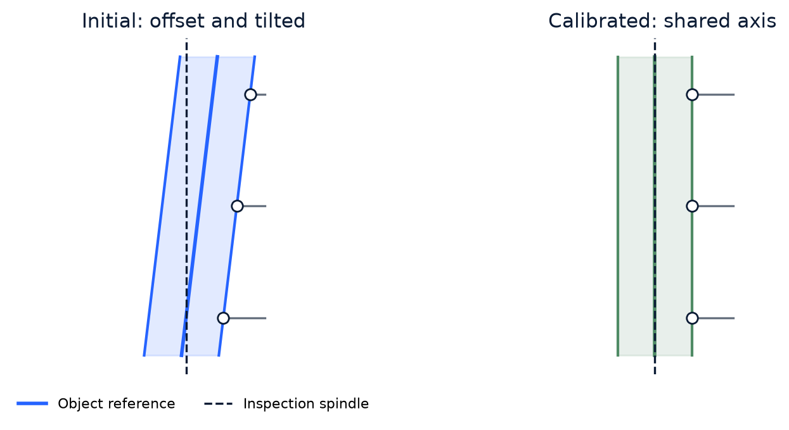
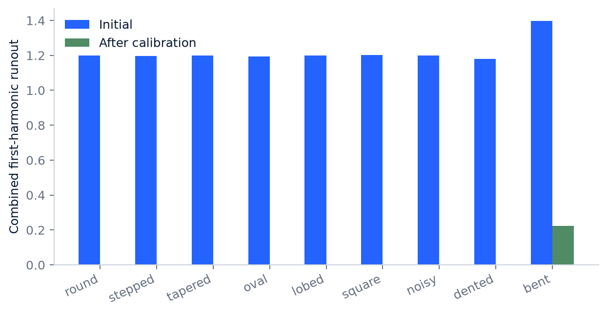
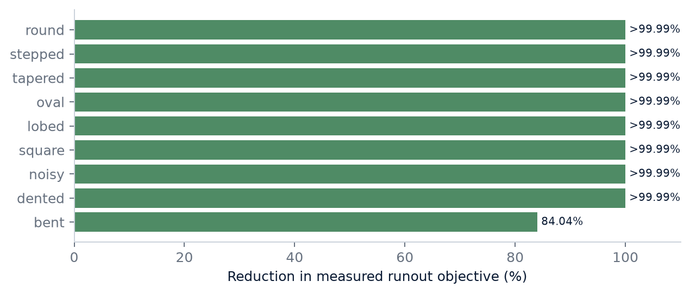

# Probe-Guided Axial Alignment of Scanned Meshes

Make Your Own World | Version 1.0

## Abstract

A scanned object can be centered on screen and still wobble when rotated. This work describes a viewport-oriented calibration workflow that uses manually placed surface probes to correct eccentricity and tilt without changing the mesh. Geometric shared-axis fitting and measured harmonic correction generate candidate updates. Independent angular sampling, per-contact protection, and explicit coverage checks determine acceptance and completion. Synthetic shapes document both successful alignment and residual runout where a single straight axis is insufficient.

Schematic of the measurement principle, not an experimental result.

## 1. The alignment problem

A bounding-box center, a surface center, and a useful rotation axis are different quantities. Changing the center can reduce eccentricity while leaving tilt. Selecting Front or Top changes the view but does not establish a useful axis when the scan coordinates are arbitrary. The objective was to automate the manual process: orient a part approximately, rotate it, observe selected surfaces, and adjust the center and direction until further correction provides no meaningful improvement.

Calibration changes a rigid reference frame. It does not cut, smooth, straighten, or replace measured geometry. The user supplies which surfaces are meaningful references. Different choices can yield different useful alignments, particularly for an asymmetric or incomplete object.

## 2. Initial center and reference frames

The rotation direction begins in the current viewport, using the selected viewport-relative direction rather than forcing an original model axis. The initial center uses triangle-area weighting so a densely triangulated patch does not dominate merely because it contains more vertices.

$$
\mathbf c_A=\frac{\sum_f A_f\mathbf c_f}{\sum_f A_f}
$$

| Symbol | Meaning |
| --- | --- |
| c_A | Initial surface-area center. |
| A_f | Area of triangle f. |
| c_f | Centroid of triangle f. |

This is a surface-area center, not a physical center of mass. A partial scan does not establish material density or a reliable volumetric center. It is an initial reference that the probes can refine.

| Frame | Meaning |
| --- | --- |
| Initial | Original model reference before correction. |
| Observed | Viewport-oriented reference used to begin inspection. |
| Calibrated | Reference after an accepted alignment correction. |

Camera navigation, inspection spin, and calibration are separate transforms. Treating spin as correction or applying a correction twice to reference axes can produce convincing but incorrect visual feedback.

## 3. Rigid correction and transform order

$$
\mathbf p=(t_x,t_y,\rho_x,\rho_y)^T,\quad\mathbf w=(\rho_x,\rho_y,0)^T
$$

| Symbol | Meaning |
| --- | --- |
| p | Four calibration parameters. |
| t_x,t_y | Translation perpendicular to the spindle. |
| rho_x,rho_y | Tilt components in radians. |
| w | Tilt rotation vector. |

Translation along the spindle does not change radial centering. Rotation around the spindle is inspection motion rather than an additional alignment parameter. The rotation-vector representation avoids treating two tilt controls as unrelated camera Euler angles.

$$
R=I+\frac{\sin\alpha}{\alpha}[\mathbf w]_\times+\frac{1-\cos\alpha}{\alpha^2}[\mathbf w]_\times^2
$$

| Symbol | Meaning |
| --- | --- |
| alpha | Length of w, giving tilt magnitude. |
| I | Identity matrix. |
| [w]_cross | Skew matrix representing cross product with w. |
| R | Rigid tilt rotation; the zero-angle case uses its continuous limit. |

$$
P(\mathbf p):\mathbf x\mapsto R\mathbf x+(t_x,t_y,0)^T
$$

| Symbol | Meaning |
| --- | --- |
| P | Rigid calibration transform. |
| x | Point in the inspection frame before calibration. |
| R | Tilt rotation from the preceding relation. |

$$
\mathbf x_s(\theta)=S_z(\theta)P(\mathbf p)M\mathbf x_m
$$

| Symbol | Meaning |
| --- | --- |
| x_m,x_s | Homogeneous model and spindle coordinates. |
| M | Model-to-inspection-frame transform. |
| S_z(theta) | Inspection rotation about the local spindle. |
| order | Calibration precedes inspection spin; the rightmost transform acts first. |

## 4. Contact probes measure the passing surface

A probe acts like a stationary measuring finger. Different points of the mesh pass underneath it. Attaching it to a vertex instead makes it follow the object and removes the intended measurement. This distinction was a central interaction correction during development.

$$
\mathbf s_g=(0,0,h_g)^T,\quad\mathbf q_g(\lambda)=\mathbf s_g+\lambda\mathbf u_g
$$

| Symbol | Meaning |
| --- | --- |
| g | Probe identifier. |
| h_g,s_g | Probe height and its station on the spindle. |
| u_g | Unit radial direction perpendicular to the spindle. |
| lambda | Segment coordinate, ranging from -L to L. |
| L | Search extent based on model size. |

A static VTK surface locator remains in model coordinates. For each inspection pose, the contact segment is transformed into that frame, intersected with the mesh, and the hit transformed back. Reusing the locator avoids rebuilding a geometry search structure for every rotation.

$$
\mathbf x_{hit}\cdot\mathbf u_g>0,\quad r_g=\mathbf x_{hit}\cdot\mathbf u_g
$$

| Symbol | Meaning |
| --- | --- |
| x_hit | Contact in spindle coordinates. |
| condition | Retain a contact on the expected near side. |
| r_g | Radial reading retained for this probe. |

A near-side hole can otherwise produce a hit on the opposite wall. Rejecting that hit prevents one class of false contact, but it does not infer all exterior-surface semantics for arbitrary incomplete geometry. Missing contacts remain missing rather than becoming zero-radius readings.

## 5. Why separated probe heights constrain tilt

One measured section can identify a center without determining a centerline direction. For small tilt, the lateral center varies approximately linearly with height. This relation explains observability; it is not a replacement for the implemented shared-axis fit.

$$
\mathbf c_\perp(h)\approx\mathbf c_0+h\mathbf\beta,\quad\mathbf\beta\approx\frac{\mathbf c_\perp(h_2)-\mathbf c_\perp(h_1)}{h_2-h_1}
$$

| Symbol | Meaning |
| --- | --- |
| c_perp(h) | Lateral center of a section at height h. |
| c_0 | Reference center offset. |
| beta | Small-angle centerline slope. |
| h_1,h_2 | Two separated probe heights. |

Several probes at nearly the same height may improve contact evidence without determining tilt. The measured solve activates four parameters when probe heights span more than 0.01 L; otherwise it restricts the solve to two centering parameters. This threshold is an implementation choice, not a metrology standard. Numerical rank is checked independently.

## 6. Separating eccentricity from real shape

The contact signal contains alignment error and actual surface geometry. Ovality, lobing, dents, and roughness should not all be forced into an axis correction. Each radial profile is fitted with a mean and the first three harmonic orders.

$$
r_g(\theta)=\mu_g+\sum_{k=1}^{3}[a_{gk}\cos(k\theta)+b_{gk}\sin(k\theta)]
$$

| Symbol | Meaning |
| --- | --- |
| r_g(theta) | Radial reading as the object rotates. |
| mu_g | Mean radius at probe g. |
| a_gk,b_gk | Harmonic coefficients. |
| k | Harmonic order, from one to three. |

$$
\widehat{\mathbf\gamma}_g=\arg\min_{\mathbf\gamma}\|X_g\mathbf\gamma-\mathbf r_g\|_2^2
$$

| Symbol | Meaning |
| --- | --- |
| gamma_g | Mean and six harmonic coefficients. |
| r_g | Vector of valid radial readings. |
| X_g | Rows contain 1, cos(theta), sin(theta), cos(2theta), sin(2theta), cos(3theta), sin(3theta). |

The first harmonic supplies the centering signal; higher harmonics accommodate additional shape variation. This is not perfect separation. Genuine asymmetry can also have a first harmonic, and unmodeled higher-frequency structure can affect finite sampling. The chosen probe surfaces define the intended datum.

The harmonic fit requires at least the greater of 12 readings and 80 percent of the sampled angles to have valid contact. Passing that numerical check is distinct from the interface completing valid angular coverage.

## 7. Runout metrics and their meaning

$$
W_g=2\sqrt{a_{g1}^2+b_{g1}^2},\quad J=\sqrt{\sum_g W_g^2}
$$

| Symbol | Meaning |
| --- | --- |
| W_g | First-harmonic peak-to-peak runout at one probe. |
| J | Combined alignment objective in model distance units. |
| factor 2 | Converts sinusoidal amplitude to peak-to-peak variation. |

$$
T_g=\max_\theta r_g(\theta)-\min_\theta r_g(\theta)
$$

| Symbol | Meaning |
| --- | --- |
| T_g | Full sampled radial range. |
| distinction | Includes real shape variation not represented by first-harmonic runout. |

A centered oval may have small W_g while retaining substantial T_g. The first metric describes the selected alignment objective; the second includes physical noncircularity. Neither is a percentage of surface reconstruction accuracy. Reporting them separately avoids implying that calibration removes real geometry.

## 8. Geometric shared-axis proposal

One candidate comes from fitting a shared axis to sampled contacts. The geometric proposal gathers 64 views, reverses the current inspection spin and correction for the sampled contacts, and retains their probe-group identities. A group can have a different radius from another group, allowing stepped or tapered parts without forcing a single cylinder.

$$
\ell(t)=\mathbf c+t\mathbf a,\quad d_i=\|(I-\mathbf a\mathbf a^T)(\mathbf x_i-\mathbf c)\|
$$

| Symbol | Meaning |
| --- | --- |
| c,a | Axis point and unit direction. |
| x_i | Contact sample in the fitting frame. |
| d_i | Perpendicular distance from sample to candidate axis. |

$$
e_i=d_i-R_{g(i)},\quad E=\sum_i[\sqrt{1+(e_i/s)^2}-1]
$$

| Symbol | Meaning |
| --- | --- |
| e_i | Radial fitting residual. |
| R_g(i) | Radius assigned to the sample contact group. |
| E | Soft-L1 robust fitting objective. |
| s | Residual scale, 0.005 after coordinate normalization. |

The initial center estimate uses a linear circle equation with separate group constants. Coordinates are centered and scaled by their extent before nonlinear refinement. Normalization makes the residual scale relative to the object rather than dependent on whether its numeric dimensions are large or small.

$$
w_i=[1+(e_i/s)^2]^{-1/4}
$$

| Symbol | Meaning |
| --- | --- |
| w_i | Row multiplier for residual and Jacobian in the weighted least-squares step. |
| effect | Large residuals receive less influence; they are not declared to be invalid geometry. |

The fit uses finite differences, a small damping term, bounds, and decreasing line-search fractions. A single-height configuration suppresses tilt. Coverage and conditioning checks can reject an insufficient sweep. Robust weighting helps with isolated readings but does not establish that an asymmetric reference surface ought to be circular.

## 9. Proposal from measured harmonic error

A second proposal directly estimates how the first-harmonic signal changes under translation and tilt. This complements the geometric proposal: an improvement in a geometric fitting objective is not automatically an improvement in the measured rotation objective.

$$
\mathbf f(\mathbf p)=(a_{11},b_{11},a_{21},b_{21},\ldots)^T
$$

| Symbol | Meaning |
| --- | --- |
| f | First-harmonic coefficient vector across probes. |
| p | Current correction parameters. |

$$
H_{ij}\approx\frac{f_i(\mathbf p+\epsilon_j\mathbf e_j)-f_i(\mathbf p)}{\epsilon_j}
$$

| Symbol | Meaning |
| --- | --- |
| H | Finite-difference sensitivity matrix. |
| epsilon_j | Translation perturbation 0.00001 L, or angular perturbation 0.00001 radians. |
| e_j | Coordinate basis vector for parameter j. |

$$
D=\mathrm{diag}(L,L,1,1),\quad\Delta\mathbf p=-D(HD)^+\mathbf f
$$

| Symbol | Meaning |
| --- | --- |
| D | Parameter scaling to balance translations and tilts. |
| (HD)^+ | Least-squares pseudoinverse of the scaled Jacobian. |
| Delta p | Candidate change in physical correction parameters. |

Numerical rank is checked against a relative threshold based on the scaled matrix norm. An underdetermined configuration returns a non-unique-axis result rather than an arbitrary correction. The code uses NumPy least squares, not SciPy's nonlinear solver.

## 10. Step bounds and independent acceptance

Individual updates are bounded to 0.08 L translation and two degrees of tilt, with a twenty-degree total tilt limit. The line search tests a bounded step and smaller fractions. These limits control a local refinement workflow after approximate manual orientation; they do not describe a universal range of object orientations.

$$
\mathbf p^{\prime}=\mathbf p+\eta\Delta\mathbf p
$$

| Symbol | Meaning |
| --- | --- |
| p_prime | Candidate correction. |
| eta | Bounded line-search fraction. |
| Delta p | Geometric or measured proposed change. |

| Stage | Sampling |
| --- | --- |
| Geometric proposal | 64 views. |
| Measured proposal | 48 angular samples. |
| Candidate screening | 96 angular samples. |
| Final acceptance | 192 samples with half-sample phase shift. |
| Additional synthetic test | 257 samples with another phase offset. |

The proposals are not accepted on their own evidence. Each is reevaluated on the same denser, independent acceptance grid. Exploratory screening permits a two-percent per-contact variation with an extent floor. Final acceptance uses the stricter protection below.

$$
W_g^{new}\leq W_g^{old}+\max(10^{-4}W_g^{old},10^{-7}L)
$$

| Symbol | Meaning |
| --- | --- |
| W_g_old,W_g_new | Independently measured runout before and after correction. |
| L | Characteristic model extent. |
| condition | Protect each established contact, allowing only small numerical variation. |

$$
J_{old}-J_{new}>\max(10^{-8}L,10^{-5}J_{old})
$$

| Symbol | Meaning |
| --- | --- |
| J_old,J_new | Combined independently measured runout. |
| absolute floor | Prevents insignificant scale-dependent numerical changes from counting as progress. |
| relative floor | Requires a useful fractional improvement in the current objective. |

When both proposals pass, the retained candidate needs to improve on the current best accepted objective as well. Independent finite sampling reduces sampling-specific false gains; it is not an exhaustive proof at every continuous angle.

## 11. Coverage, convergence, and stable inspection

A completed turn is not sufficient if a probe lost contact. Coverage is tracked separately in 72 five-degree bins for each active probe. A bin records valid contact only while the displayed correction is settled and no probe is being dragged.

$$
C=\frac{\sum_g\sum_{b=1}^{72}v_{gb}}{72G}
$$

| Symbol | Meaning |
| --- | --- |
| v_gb | One when valid settled contact was observed for probe g in angular bin b. |
| G | Number of active probes. |
| C | Observed coverage fraction, distinct from fit accuracy. |

A meaningful correction invalidates coverage because earlier readings belonged to a different pose. More than one turn can therefore be useful. Repeating an unchanged settled turn should not manufacture further improvement. Stability requires complete coverage, a settled displayed pose, an available fit result, a completed solve with no accepted update, and no outstanding solve.

Once stable, detection stops and probes disappear while rotation continues for inspection. Finalize locks the frame and returns to Optimize. New manual probes can resume detection. Automatic probe placement and pruning were tried and removed after poor interaction; they are not current features.

## 12. Responsive inspection without changing the fit

Surface-search construction and fitting run outside the render callback. Generation ownership prevents an obsolete result from replacing a newer correction. Reusing geometry and coalescing render updates reduces redundant presentation work. Stable inspection no longer needs repeated fitting.

$$
\mathbf p_{display}^{new}=\mathbf p_{display}+(\mathbf p_{target}-\mathbf p_{display})(1-e^{-\Delta t/\tau})
$$

| Symbol | Meaning |
| --- | --- |
| p_display,p_target | Displayed pose and accepted target pose. |
| Delta t | Elapsed callback time. |
| tau | Visual tracking time constant. |
| separation | Acceptance uses numerical target evaluations, not the smoothed display. |

Smoothing affects how an accepted correction is shown, not whether it passes. Without this distinction, animation could be confused with continuing numerical improvement. GPU rendering and numerical contact fitting also represent different workloads; this report does not claim a GPU fitting speedup.

## 13. Synthetic experiments

Nine intentionally misaligned fixtures were generated with 96 angular sections and seven height rings. Three probes at heights -3, 0, and 3 supplied multi-height evidence. Initial translation was (0.23, -0.17), and tilt-vector components were (0.065, -0.045) radians. Model extent for the fitting controls was 14. Each accepted change was checked on an additional 257-angle grid, followed by a no-further-update recheck at convergence.

Independent synthetic-profile results. Bars show combined first-harmonic runout before and after correction. Small final values are not presented as perfect physical accuracy.

| Fixture | Accepted steps | Runout reduction | Seconds |
| --- | --- | --- | --- |
| Round | 4 | >99.99% | 2.686 |
| Stepped | 4 | >99.99% | 2.719 |
| Tapered | 4 | >99.99% | 2.732 |
| Oval | 4 | >99.99% | 3.005 |
| Lobed | 4 | >99.99% | 3.068 |
| Square | 4 | >99.99% | 3.048 |
| Noisy | 4 | >99.99% | 3.343 |
| Dented | 3 | >99.99% | 2.399 |
| Bent | 2 | 84.04% | 1.723 |

Timings are single recorded numerical-loop runs, including the independent checks and stable-fit recheck. They exclude mesh loading and animated full-turn inspection, and are not hardware-independent performance guarantees. The complete unrounded initial and final values accompany this paper.

The bent fixture retained approximately 15.96 percent of its original objective. Its centerline changes along its length, so one straight axis cannot align every section simultaneously. Residual wobble is an informative result, not a reason to deform the source or report false completion accuracy.

Reduction calculated from unrounded values. Near-zero synthetic residuals are labeled greater than 99.99 percent rather than exact 100 percent.

Focused checks also cover incomplete contact, insignificant numerical changes, regressions, and orientation helpers. An incomplete-contact fixture is expected to fail calibration rather than report success. These tests establish specific numerical and behavioral properties; they do not certify every scan or a physical measuring instrument.

## 14. Failures and design changes

| Observed problem | Why it mattered | Design response |
| --- | --- | --- |
| Vertex-attached probes | Followed the object instead of observing passing geometry. | Fixed-spindle contact sampling. |
| Opposite-wall contacts | A near-side gap could produce misleading far-side readings. | Reject the wrong radial half-space. |
| One-contact improvement | Could undermine another established contact. | Joint fit and per-contact final protection. |
| Sparse validation | Gains could depend on chosen sample angles. | Denser phase-shifted acceptance. |
| Reference transforms mixed | Spin or repeated correction could mislabel the displayed axes. | Separate model reference, observed frame, correction and inspection spin. |
| Analysis continued after convergence | Consumed work without new evidence. | Separate completed detection from rotating inspection. |
| Automatic placement and pruning | Produced unreliable interaction. | Retain manual probe placement and explicit clearing. |

These failures were not all solver failures. Contact selection, transform bookkeeping, observability, validation, and interaction each affected whether the mathematical result was useful. No quantitative ranking of withdrawn approaches is inferred where comparable measurements were not recorded.

## 15. Limitations and interpretation

A selected surface may not possess the intended symmetry. One height may not constrain tilt. An incomplete or internal surface can give ambiguous contact. A bent part may have no single straight axis. Higher-frequency shape can interact with discrete sampling. The local search bounds assume an approximately useful starting orientation. These are reasons to expose residuals and allow manual refinement rather than imply a universal automatic alignment.

Runout reduction measures the stated objective. It is not mesh simplification quality, reconstruction accuracy, or metrology traceability. The method leaves pairwise distances in the source mesh unchanged because its corrections are rigid. The useful output is a better inspection and working frame, not altered physical geometry.

## 16. Reproducibility and research record

The package supplies synthetic fixture code, numerical implementation snapshots, unrounded result data, focused regression results, and a runner for a matching MeshMill 0.4 checkout. The snapshots are inspection sources, not an independently packaged application. A source manifest records their hashes. The tests require NumPy, VTK and the application test environment; they do not require a scanned part.

This record preserves what was tried, why it was tried, what was built, what was observed, and how the results were interpreted. Useful adaptation and overlap with established work are worth documenting. References distinguish incorporated numerical tools from background mathematics. Additional references and constructive corrections are welcome.

## 17. References and implementation roles

- [NIST, Roundness measurements](https://www.itl.nist.gov/div898/handbook/mpc/section3/mpc344.htm): Measurement background; not certification of this implementation.
- [Lynch and Park, Modern Robotics](https://modernrobotics.northwestern.edu/): Rigid-motion mathematical background.
- [NumPy, numpy.linalg.lstsq](https://numpy.org/doc/stable/reference/generated/numpy.linalg.lstsq.html): Incorporated numerical least-squares API.
- [VTK, vtkStaticCellLocator](https://vtk.org/doc/nightly/html/classvtkStaticCellLocator.html): Incorporated surface-intersection infrastructure.
- [SciPy, least_squares documentation](https://docs.scipy.org/doc/scipy/reference/generated/scipy.optimize.least_squares.html): Soft-L1 mathematical reference; the SciPy solver is not used here.
