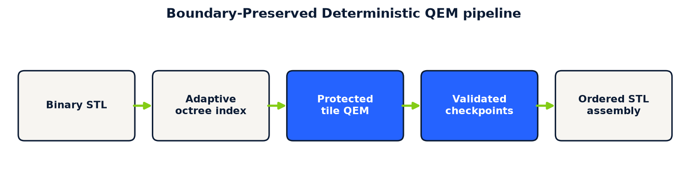
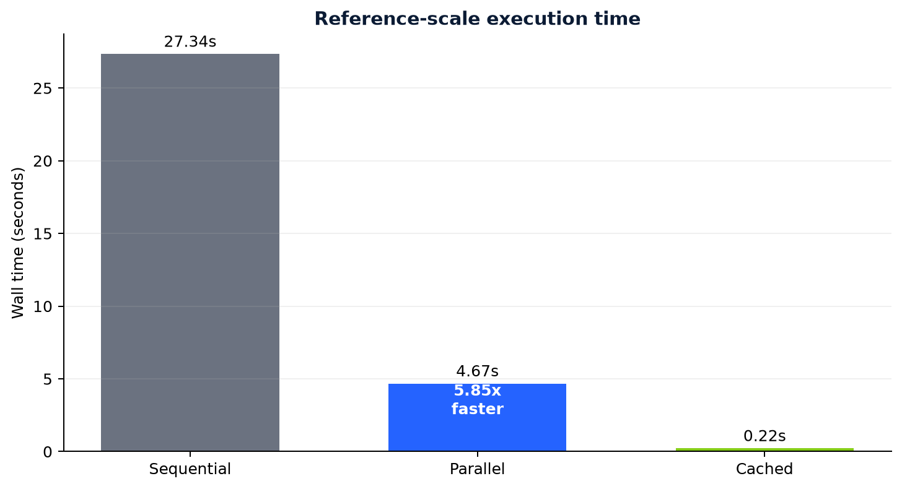
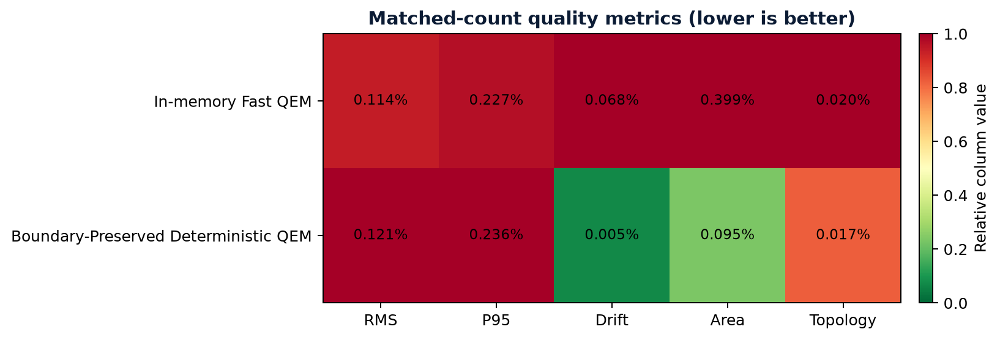
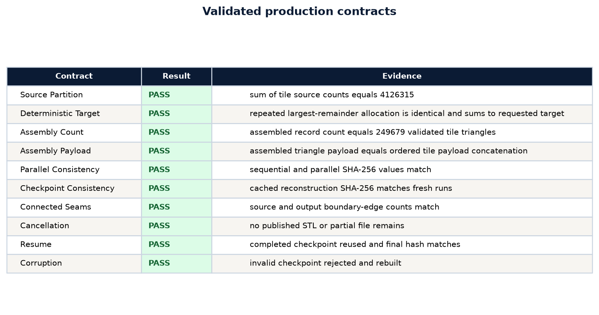

# Boundary-Preserved Deterministic QEM

## Out-of-Core Simplification for Large Triangle Meshes

## Abstract

Large triangle meshes can exceed practical working-memory limits even when their binary STL files
fit on disk. This report describes a bounded-memory optimization path that partitions a binary STL
into deterministic adaptive octree tiles, simplifies tiles concurrently, protects tile boundaries,
checkpoints each result, and assembles a final STL without constructing a global vertex or face
array. On a 4,126,315-triangle reference mesh, eight CPU workers completed the tiled reduction in
4.67 seconds compared with 27.34 seconds for one worker, a 5.85x speedup. Sequential, parallel, and
cached runs produced byte-identical 249,679-triangle outputs. The requested count was 249,184;
495 triangles were retained because boundary preservation has priority over forcing the target.
Automated connected-surface tests detected zero assembly loss and no additional open boundary
edges at tile seams.

## 1. Problem and design constraints

In-memory simplification requires the source triangle records, welded vertices, indexed faces,
quadrics, adjacency data, and temporary collapse state at the same time. The amplification from
file size to working memory makes a sufficiently large mesh fail before simplification begins.

The tiled path uses these contracts:

1. Peak geometry state is bounded by tile size and concurrent worker count.
2. Every source triangle has exactly one persistent tile owner.
3. Coordinates on tile-open edges remain unchanged.
4. A completed tile is reusable after interruption and independently checksum-validated.
5. Parallel completion order does not affect output ordering.
6. The final STL is published atomically only after count validation.

The problem is more than dividing a file. A partitioned reducer must resolve six coupled failures:

- **ownership:** duplicated overlap triangles inflate geometry, while gaps lose geometry;
- **continuity:** independently moved partition edges create cracks;
- **budgeting:** rounded per-tile targets can miss the requested global target;
- **scheduling:** unrestricted workers recreate the memory exhaustion partitioning was meant to
  avoid;
- **recovery:** a long run must survive interruption without trusting incomplete output; and
- **ordering:** parallel completion order must not change the final file.

### 1.1 QEM reduction inside a tile

For plane $p=(a,b,c,d)^T$ and homogeneous vertex
$\bar{\mathbf{v}}=(x,y,z,1)^T$, its quadric is

$$
Q_p=pp^T.
$$

The quadric accumulated at a vertex is

$$
Q_v=\sum_{p\in P(v)}Q_p,
$$

and the contraction error for vertices $v_1$ and $v_2$ at candidate position
$\bar{\mathbf{v}}'$ is

$$
E(\bar{\mathbf{v}}')=
\bar{\mathbf{v}}'^T(Q_{v_1}+Q_{v_2})\bar{\mathbf{v}}'.
$$

$p$ is an incident face plane, $P(v)$ is the set of planes incident on $v$, $Q_v$ is the
accumulated symmetric error matrix, and $E$ estimates squared geometric error. The local reducer
performs these contractions. Boundary-Preserved Deterministic QEM supplies spatial ownership,
protected boundaries, scheduling, validation, recovery, and assembly around it.

## 2. Spatial ownership

For triangle $f$ with vertices $\mathbf{x}_{f,1}$, $\mathbf{x}_{f,2}$, and
$\mathbf{x}_{f,3}$, its persistent owner is selected from its centroid:

$$
\mathbf{c}_f=\frac{\mathbf{x}_{f,1}+\mathbf{x}_{f,2}+\mathbf{x}_{f,3}}{3}.
$$

The centroid is quantized at octree level $l$ inside the mesh bounds and encoded with a Morton
code. A leaf is subdivided while its measured triangle count exceeds the configured tile target.
Centroid ownership avoids duplicating source triangle records in the persistent index.

For mesh lower bound $\mathbf{b}_{min}$, extent $\mathbf{d}$, and grid width $g=2^l$, the integer
cell coordinate is

$$
\mathbf{u}_f=\mathrm{clip}\left(
\left\lfloor g\frac{\mathbf{c}_f-\mathbf{b}_{min}}
{\max(\mathbf{d},\epsilon)}\right\rfloor,0,g-1\right).
$$

$\mathbf{u}_f$ is the integer cell coordinate, $l$ is the octree level, and $\epsilon$ prevents
division by zero on a flat axis. Interleaving the coordinate bits gives the Morton code. Stable
sorting by level and code makes index creation reproducible.

## 3. Deterministic target allocation

For tile $i$, let $n_i$ be its source triangle count and $m_i=\min(4,n_i)$ its minimum allocation.
The distributable capacity $C$ and remaining budget $R$ are

$$
C=\sum_i(n_i-m_i),\qquad R=T-\sum_i m_i.
$$

For requested global target $T$, the proportional quota is

$$
q_i=(T-\sum_jm_j)\frac{n_i-m_i}{\sum_j(n_j-m_j)}.
$$

The initial tile target is $m_i+\lfloor q_i\rfloor$. Remaining triangles are assigned in descending
order of the fractional part of $q_i$, with tile order as the tie breaker:

$$
t_i=m_i+\lfloor q_i\rfloor+r_i,\qquad r_i\in\{0,1\},\qquad \sum_i t_i=T.
$$

$C$ is total capacity above tile floors, $R$ is the target remaining after those floors, $q_i$ is a
real-valued quota, $r_i$ is the largest-remainder correction, and $t_i$ is the requested tile
target. A boundary-constrained simplifier may return more than $t_i$.
The implementation records the actual result and does not delete protected geometry to force the
requested count.

For actual tile results $F'_i$, the final count and boundary-retention overhead are

$$
T'=\sum_i|F'_i|,\qquad R_B=T'-T.
$$

$T'$ is the validated output count and $R_B$ is the count retained above the request. On the
reference mesh, $R_B=495$. This avoids a damaging cleanup pass whose sole purpose would be to make
the counter exact.

## 4. Boundary contract

Within tile $i$, let $c_i(e)$ be the number of incident tile triangles for edge $e$. Vertices on
edges with one incident triangle form the protected set

$$
B_i=\{v:v\in e\ \text{and}\ c_i(e)=1\}.
$$

The simplifier preserves open boundaries, and the result is rejected unless every protected
float32 source coordinate remains present:

$$
\mathbf{x}'_v=\mathbf{x}_v\quad\text{for every }v\in B_i.
$$

This is conservative. It can retain more triangles near partitions, but it prevents independent
workers from moving the coordinates used to reconnect neighboring triangle groups.

Binary STL stores float32 coordinates. The implementation therefore compares protected coordinate
bit patterns at that precision:

$$
\forall v\in B_i,\ \exists v'\in V'_i:
\mathrm{float32}(\mathbf{x}_{v'})=
\mathrm{float32}(\mathbf{x}_v).
$$

$V'_i$ is the optimized vertex set for tile $i$. This is stricter than a tolerance comparison and
matches the precision used during assembly.

### 4.1 Alternatives that failed the production contract

- **Unrestricted local QEM** moved partition edges independently and could open cracks.
- **Overlapping triangle ownership** reduced cracks but duplicated geometry and made ownership and
  counting ambiguous.
- **Post-assembly welding alone** could merge coincident coordinates but could not repair boundary
  curves already moved differently by independent reducers.
- **Forced exact output after constrained reduction** discarded geometry retained for continuity.
- **Completion-order assembly** made output depend on process scheduling.
- **One open stream per tile** allowed file-handle use to grow with mesh size.
- **Workers based only on CPU count** allowed concurrent tile state to exceed the memory budget.
- **One temporary result** discarded completed work after interruption.

The accepted method keeps one owner per source triangle, freezes tile-open coordinates, assembles
in stable order, limits file handles and worker memory, and checkpoints every tile independently.

## 5. Resource and recovery model

The persistent index stores raw 50-byte STL triangle records. Index creation keeps at most 64 tile
files open. Each worker loads one tile, welds equal coordinates locally, simplifies it, and writes
an atomic compressed checkpoint containing points, faces, and a SHA-256 checksum.

The worker limit is bounded by the configured process count and available geometry memory:

$$
W=\min\left(W_{configured},\left\lfloor\frac{M_{budget}}{
\max(64\text{ MiB},320n_{max})}\right\rfloor\right),
$$

where $n_{max}$ is the largest pending tile count. The 320-byte factor is a conservative allowance
for welded geometry, adjacency, quadrics, and temporary native reducer state.

Including pending work count $N_P$, the implemented bound is

$$
W=\max\left(1,\min\left(W_{configured},
\left\lfloor\frac{M_{budget}}{M_W}\right\rfloor,N_P\right)\right),
$$

where $M_W=\max(64\text{ MiB},320n_{max})$. $W$ is the active worker count, $M_{budget}$ is the
configured geometry-memory budget, and $M_W$ is the conservative per-worker estimate. GPU-guided
algorithms use one worker because independent processes would contend for the selected device.

The run manifest identifies the source fingerprint, parameters, completed tiles, actual counts,
and final output checksum. Corrupt checkpoints are rebuilt. Cancellation retains valid tile
checkpoints, removes partial assembly output, and leaves no published incomplete STL.

For checkpoint point bytes $P_i$ and face bytes $F_i$, integrity is

$$
H_i=\mathrm{SHA256}(P_i\Vert F_i).
$$

$H_i$ is stored beside the arrays. Reuse also requires valid shapes, valid face indices, and a face
count between one and the tile source count. The source index uses a bounded invalidation
fingerprint; final output files receive a complete streamed SHA-256.

## 6. Streamed assembly and loss definition

Validated tile results are read in deterministic tile-number order. Normals are recomputed and
triangle records are written directly to a temporary binary STL. The file is atomically renamed
only after flushing, synchronizing, and validating its declared triangle count.

For stable ascending tile order $\pi$, assembly is

$$
F_{STL}=F'_{\pi(1)}\Vert F'_{\pi(2)}\Vert\cdots\Vert F'_{\pi(k)}.
$$

$F'_i$ is the validated output sequence for tile $i$. Worker completion order is absent from this
equation, so scheduling can affect runtime but not file order.

For output triangle vertices $\mathbf{a}$, $\mathbf{b}$, and $\mathbf{c}$, the STL normal is
recomputed as

$$
\mathbf{n}=\frac{(\mathbf{b}-\mathbf{a})\times(\mathbf{c}-\mathbf{a})}
{\lVert(\mathbf{b}-\mathbf{a})\times(\mathbf{c}-\mathbf{a})\rVert_2},
$$

with a zero normal when the cross-product norm is zero.

Assembly loss is distinct from simplification reduction:

$$
L_{assembly}=\sum_i |F'_i|-|F_{STL}|.
$$

All measured runs produced $L_{assembly}=0$. This establishes that the assembly stage did not omit
validated tile triangles. It does not mean simplification preserved every source triangle, because
reduction is the purpose of the operation.

Simplification reduction is a separate quantity:

$$
R_S=1-\frac{|F_{STL}|}{|F_{source}|}.
$$

$R_S$ measures intended reduction. $L_{assembly}$ measures whether any already-approved result
disappeared during writing.

### 6.1 Determinism argument

Source fingerprint and operation parameters determine the run key. Bounds and tile counts determine
adaptive leaves. Stable level and Morton order determine tile numbering. Largest-remainder
allocation uses tile number to resolve ties. Each reducer sees the same records, target, boundary
constraint, and settings. Assembly reads results by tile number. Under a deterministic local
reducer, the complete mapping is

$$
(H_s,T,A,G)\longmapsto H_{out},
$$

where $H_s$ is the source fingerprint, $T$ is target, $A$ is algorithm, $G$ is its settings, and
$H_{out}$ is the full output hash. The reference trials produced the same $H_{out}$ across
sequential, parallel, and cached execution.

## 7. Evaluation

### 7.1 Reference mesh

The reference binary STL contains 4,126,315 triangles and was indexed into 50 adaptive tiles. The
requested result was 249,184 triangles. Boundary constraints retained 495 additional triangles.

| Run | Workers | Time | Cached tiles | Output triangles | Assembly loss |
|---|---:|---:|---:|---:|---:|
| Sequential | 1 | 27.34 s | 0 | 249,679 | 0 |
| Parallel | 8 | 4.67 s | 0 | 249,679 | 0 |
| Cached validation and assembly | 1 active | 0.22 s | 50 | 249,679 | 0 |

Parallel speedup was 5.85x. All three files were 12,484,034 bytes and had SHA-256
`00455d33955b99149db58e70293484cacbc71372879ea61bcd693abd2133c713`.

Speedup and worker efficiency are

$$
S_W=\frac{t_1}{t_W},\qquad \eta_W=\frac{S_W}{W}.
$$

$t_1$ is sequential time, $t_W$ is time with $W$ workers, $S_W$ is speedup, and $\eta_W$ is
efficiency. Here, $S_8=5.85$ and $\eta_8=0.73$. Process startup, storage traffic, unequal tile
costs, serialization, and streamed assembly account for the difference from ideal scaling.

Compared at approximately 249,000 triangles, the tiled path had slightly higher sampled surface
distance but lower bounds drift, area change, and non-manifold rate than in-memory Fast QEM:

| Measurement | In-memory Fast QEM | Tiled Fast QEM |
|---|---:|---:|
| Runtime | 8.58 s | 4.67 s |
| RMS sampled surface error | 0.114% | 0.121% |
| P95 sampled surface error | 0.227% | 0.236% |
| Dimension drift | 0.068% | 0.005% |
| Surface-area change | 0.399% | 0.095% |
| Non-manifold rate | 0.020% | 0.017% |

These measurements apply to the reference fixture and machine. They do not establish universal
superiority.

For sampled source point $\mathbf{x}_s$, nearest output point $\mathbf{y}_s$, source diagonal $D$,
and sample count $S$:

$$
D_{RMS}=\frac{100}{D}\sqrt{\frac{1}{S}\sum_{s=1}^{S}
\lVert\mathbf{x}_s-\mathbf{y}_s\rVert_2^2},
$$

$$
D_{95}=\frac{100}{D}\mathrm{percentile}_{95}\left(
\lVert\mathbf{x}_s-\mathbf{y}_s\rVert_2\right).
$$

$D_{RMS}$ measures average sampled displacement, while $D_{95}$ exposes the higher-error tail.
Dimension drift is $\delta_j=100|d'_j-d_j|/D$. Area error is
$D_A=100|A'-A|/A$. Non-manifold rate is
$D_N=100|\{e:c'(e)>2\}|/|F'|$. No one metric proves quality, so all are reported.

### 7.2 Connected-surface contract fixture

A 260 by 130 quad grid, triangulated into 67,600 faces, crosses multiple spatial tiles. Automated
tests reduce it to a 50,000-triangle request and verify:

- output count equals the sum of validated tile results;
- the output boundary-edge count equals the source boundary-edge count;
- sequential and parallel output files are byte-identical;
- cancellation publishes no output or partial file;
- resumption reuses completed tile checkpoints and reproduces the same file; and
- a deliberately corrupted checkpoint is detected and rebuilt.

Matching boundary-edge counts on this connected fixture show that the tested partition introduced
no open tile seams. Broader adversarial fixtures remain appropriate, including curved seams,
non-manifold inputs, thin shells, intersecting layers, and extreme coordinate ranges.

For exact-coordinate welded edges, boundary-edge count is

$$
N_B=|\{e:c(e)=1\}|.
$$

The test requires $N_B^{output}=N_B^{source}$. This detects artificial openings on the connected
fixture. It does not claim to repair openings or non-manifold edges already present in the source.

## 8. Interpretation and limitations

The result establishes a production-oriented, bounded-memory pipeline with deterministic assembly
and tested seam behavior. The current boundary method is conservative and established in nature.
Octrees, Morton ordering, centroid ownership, boundary-constrained simplification, proportional
allocation, checkpoints, and streamed binary output are not claimed as new techniques.

The current tests do not prove watertightness for a source mesh that was already open or
non-manifold. They prove that assembly preserved every validated result triangle and that the
connected test fixture gained no new open boundary edges. GPU-guided tiled modes require separate
matched-count benchmarks because launching small GPU workloads per tile can change their runtime
profile.

### 8.1 What the result proves

The measured contracts are deliberately narrower than a general topology theorem. They establish
that each source triangle has one persistent owner, each accepted tile result is represented in the
assembled count, protected partition coordinates survive local reduction, valid checkpoints are
reusable, invalid checkpoints are rejected, and stable assembly produces the same bytes across the
tested execution schedules. These are the failure points that make a nominally fast partitioned
reducer unsafe for production use.

The connected-grid test also establishes that the tested partition did not add open boundary edges.
It does not establish that every possible input remains manifold, watertight, or free of
self-intersections. Those are separate properties and require separate tests.

### 8.2 Why the alternatives were insufficient

The unsuccessful approaches were useful because each isolated a different requirement:

1. Independent local QEM was fast, but moving shared partition geometry allowed neighboring tiles
   to disagree about the seam.
2. Overlapping ownership supplied context, but duplicate triangle ownership made the final count
   and assembly ambiguous.
3. A welding pass could join coordinates that already agreed. It could not reconstruct a boundary
   curve after two reducers moved it differently.
4. Removing protected triangles after reduction reached an exact count by violating the continuity
   constraint that caused the excess.
5. Collecting worker results as they finished preserved counts but made output order depend on
   scheduling.
6. Scaling workers from logical CPU count alone improved concurrency until simultaneous native
   reducer state exceeded the intended memory bound.
7. Reusing a checkpoint without content validation made a truncated or stale file indistinguishable
   from completed work.

The final method keeps the useful part of each experiment while making the conflict explicit:
geometry ownership is singular, context is local, boundary coordinates are immutable, target
allocation is deterministic, concurrency is memory-bounded, checkpoints are content-validated,
and assembly order is independent of completion order.

### 8.3 Remaining engineering limits

- Boundary retention is conservative. A shared-boundary optimizer could lower the 495-triangle
  overhead, but it would need to preserve determinism and restartability.
- The reference index targets binary STL. Other mesh formats need equivalent streamed readers and
  explicit handling for shared attributes.
- The current source fingerprint is bounded for fast invalidation. The completed output receives a
  full streamed SHA-256, while applications that require cryptographic source identity should also
  request a full source hash.
- Tile costs differ because equal triangle counts do not imply equal welded topology or equal QEM
  work. Dynamic scheduling reduces idle time, but perfect worker efficiency is not expected.
- GPU-guided reducers are restricted to one process until shared-device memory, initialization, and
  contention are measured under the tiled workload.









## 9. Relationship to prior work

Garland and Heckbert introduced iterative pair contraction with accumulated quadric error matrices
for efficient surface simplification. Lindstrom described an out-of-core method that combines
clustering with quadric placement for datasets larger than memory. Cignoni and colleagues described
an octree-based external-memory mesh whose block-boundary vertices are not collapsed during local
simplification. These publications establish the relevant QEM, external-memory, octree, and locked
boundary foundations. The present work applies related principles to a resumable production
pipeline and evaluates its determinism, cancellation, and assembly contracts.

1. M. Garland and P. Heckbert, "Surface Simplification Using Quadric Error Metrics," SIGGRAPH 1997. https://publications.ri.cmu.edu/surface-simplification-using-quadric-error-metrics
2. P. Lindstrom, "Out-of-Core Simplification of Large Polygonal Models," SIGGRAPH 2000. https://www.cs.princeton.edu/courses/archive/spr01/cs598b/papers/lindstrom00.pdf
3. P. Cignoni et al., "External Memory Management and Simplification of Huge Meshes." https://www.cs.upc.edu/~pere/PapersWeb/SGI/Cignoni.pdf

## 10. Reproduction

The production benchmark accepts any binary STL, requested target, and worker count. It clears the
result cache between sequential and parallel trials, retains the parallel result for the cached
trial, emits JSON, and exits unsuccessfully if hashes or assembled counts disagree.

```text
python experiments/code/benchmark_boundary_preserved_deterministic_qem.py INPUT.stl \
  --target 249184 --workers 8 --output BENCHMARK_DIRECTORY
```

The implementation and tests are maintained in MeshMill. The normalized reference result is stored
with this report.

## 11. Conclusion

The tiled path processed the reference mesh faster than the measured in-memory Fast QEM path while
bounding geometry state, preserving partition boundaries, and producing deterministic output. Its
main cost is conservative boundary retention. Future work can reduce that overhead through shared
boundary optimization, but it should preserve the same cancellation, checkpoint, determinism, and
assembly-loss contracts.
