# From Surface Evidence to a Hollow Split Clamshell

Version 1.0.

## Abstract

MeshMill turns a source surface into a hollow enclosure with a shaped cavity and two closed clamshell halves. The construction separates surface preparation, clearance, gap bridging, outer-body shape, and splitting so each operation has a clear purpose. Cross-sections show the cavity and surrounding material; direct measurements explain the effect of normal offsets and sampled splitting. Application and SketchUp images show how the generated geometry is used.

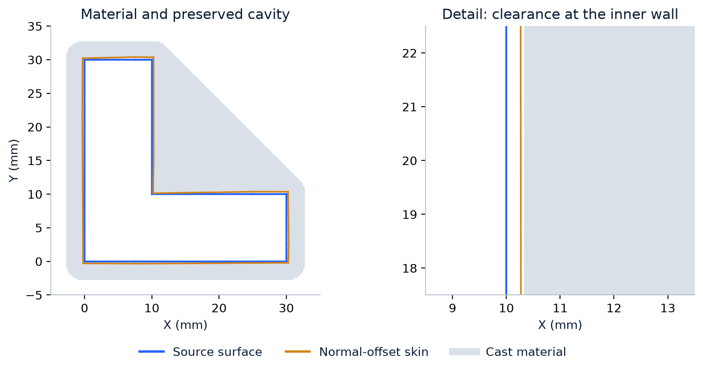

## 1. Define the output as material around a cavity

Think of the source mesh as the object that will sit inside the finished housing. The cavity is the space reserved for that object. The outer body describes the outside of the housing. Subtracting the cavity from the outer body leaves the material that can be printed or edited. This is the negative of the source shape, not another solid copy of it.

$$
M=O\setminus C
$$

| Symbol | Meaning |
| --- | --- |
| O | Outer enclosure: fitted hull-based Blob or bounding Box. |
| C | Cavity inferred from the clearance surface. |
| M | Remaining cast material. |

In the section images, white space inside the enclosure is the cavity and gray is material. The blue line is the original source surface. The orange line is the displaced skin used to prepare the cavity. Reading those separately makes it possible to see whether there is clearance, whether an unwanted island remains, or whether a recess has been bridged away.

An outward surface imprint and a negative clamshell are different objects. The first follows the skin; the second leaves that shape empty inside surrounding material. Clearance, wall thickness, gap bridging, and split orientation each change a different part of the construction. Combining them into one generic strength control would obscure their effects.

Box creates a rectangular exterior that is straightforward to position and split. Blob uses a fitted hull-based exterior around the source. Both subtract the same separately constructed cavity, so the outer-body choice controls the surrounding material rather than redefining the source shape.

## 2. Complete measured support before interpreting empty space

A scan can contain gaps and several layers of geometry. The cavity construction distinguishes an observed exterior hit from a ray passing through a gap to another surface. That distinction keeps the selected exterior skin, rather than copying every encountered layer into the mold.

A validated prepared solid can be rasterized directly as occupied cavity volume. For incomplete input, a hull prior is refined from six axis-aligned views. A nearest front-facing hit certifies free space before that hit. A miss or back-facing hit remains unknown, rather than evidence that a cavity or wall exists on the opposite side. The prepared-solid route supplies stronger evidence and was used in the controlled cast fixture.

Earlier camera-only imprinting covered the visible side but missed the back and bottom. Including every scan layer reproduced unwanted internal geometry. The all-sided construction and supported-free-space rule address those observations directly.

With a prepared closed solid, grid points are classified against its boundary. With incomplete input, the directional views remove space supported as free by a suitable front-facing hit. Unmeasured regions retain their prior classification. This is how the method uses the surface evidence that is present without treating a missing observation as another wall.

Solid completion supplies a closed source boundary when preparation is selected. Cast then uses that boundary to construct the cavity and enclosing material. Keeping these stages separate makes their roles clear: completion prepares the source; Cast produces the housing around it.

## 3. How the clearance is constructed

The clearance control moves each vertex along its averaged surface normal. On a flat region that direction follows the face normal. At a corner, the averaged direction combines the neighboring faces, dividing the movement among their normal directions.

$$
v_i^{\prime}=v_i+\delta\widehat n_i
$$

| Symbol | Meaning |
| --- | --- |
| v_i,v_i_prime | Original and displaced vertex. |
| delta | Requested displacement, 0.5 mm in the fixture. |
| n_hat_i | Normalized averaged vertex normal used by the implementation. |

The setting measures displacement along the averaged vertex normal. Projecting that displacement onto a neighboring face gives its perpendicular clearance contribution. The following relation explains the distances observed in the cross-sections.

$$
c_{face}\approx\delta(\widehat n_i\cdot n_f)=\delta\cos\phi
$$

| Symbol | Meaning |
| --- | --- |
| c_face | Displacement component perpendicular to a neighboring flat face. |
| n_f | Unit face normal. |
| phi | Angle between averaged vertex normal and face normal. |
| delta, n_hat_i | Requested vertex displacement and averaged unit vertex normal from Relation 2. |

At a three-face right-angle corner, an equally averaged normal gives delta divided by the square root of three along each face normal. A 0.5 mm vertex movement can therefore correspond to about 0.29 mm face-normal clearance. The cast grid adds its own sampling variation. This distinction is measured below rather than hidden behind the requested setting.

| Sampled location | Requested (mm) | Skin distance (mm) | Cavity distance (mm) |
| --- | --- | --- | --- |
| Bottom edge | 0.50 | 0.295 | 0.408 |
| Right end | 0.50 | 0.325 | 0.392 |
| Notch horizontal | 0.50 | 0.285 | 0.442 |
| Notch vertical | 0.50 | 0.268 | 0.328 |
| Top end | 0.50 | 0.332 | 0.392 |
| Left edge | 0.50 | 0.295 | 0.408 |

Six radial rays were measured from known flat source faces at z = 2 mm. With a 0.5 mm requested vertex displacement, skin distances ranged from approximately 0.268 to 0.332 mm and final cavity distances from approximately 0.328 to 0.442 mm. The table records the geometry produced by the normal-offset and sampling stages.

The cavity-distance column measures the final separation at each test location. Comparing it with the skin-distance column shows the contribution of grid extraction. The measurements explain how the requested vertex movement becomes the clearance visible in the generated cavity.

## 4. Geometry-derived sampling and memory

The cavity and surrounding material are sampled on a three-dimensional grid. A smaller grid step can describe finer details, but it creates many more sample points. Halving the step in all three directions requires roughly eight times as many points before accounting for padding. That is why a seemingly small detail adjustment can have a large memory cost.

$$
h_0=\min(L/(192d),w/4),\qquad N=\prod_{k=1}^{3}(\lceil(L_k+2p)/h\rceil+1)
$$

| Symbol | Meaning |
| --- | --- |
| h_0,h | Requested automatic pitch and actual pitch. |
| L,L_k | Largest extent and per-axis extents. |
| d,w | Detail multiplier and wall thickness. |
| p | Padding: wall plus bridge plus four grid steps. |
| N | Grid-point count. |

$$
B\approx128N,\qquad h_{new}=h\max(1.02,1.02(N/N_{budget})^{1/3})
$$

| Symbol | Meaning |
| --- | --- |
| B | Conservative memory estimate in bytes, not measured peak usage. |
| N_budget | Grid budget derived from selected memory. |
| h_new | Coarsened pitch; padding and dimensions are recomputed until the plan fits. |
| N, h | Grid-point count and current grid pitch. |
| 128 | Estimated working bytes per grid point used by the planner. |

Pitch sets the spatial resolution of the sampled construction. The planner adjusts it to the memory budget, and the output records the actual value. This makes the resolution used to build the cavity an explicit part of the result.

The planner derives the initial step from object size, requested detail, and wall thickness. It then checks the estimated working set against the memory budget. When adjustment is needed, it increases the step and recalculates the grid. The 128-byte-per-point estimate accounts for the arrays and intermediate stages used during construction.

The actual pitch also determines how many cells represent the requested bridge span and wall construction. Recording it alongside the parameters makes the generated geometry reproducible.

## 5. Bridge gaps and form the outer body

Gap bridging connects small breaks in cavity occupancy by expanding and then contracting the occupied region. The chosen span determines the size of the closing operation. Keeping it separate from clearance allows gaps to be bridged without using extra source displacement as a substitute.

$$
r=\lceil g/(2h)\rceil,\qquad C^{\prime}=(C\oplus K_r)\ominus K_r
$$

| Symbol | Meaning |
| --- | --- |
| g | Requested gap-bridging span. |
| K_r | Discrete structuring element with radius r cells. |
| oplus,ominus | Morphological dilation and erosion. |
| C_prime | Cavity after closing. |
| h, r | Grid pitch and integer closing radius. |
| C | Binary sampled cavity region before closing. |

After closing, enclosed complement islands are filled relative to the exterior-connected region. Blob builds a hull-based outer region and adds sampled wall material; Box expands the bounds. The cavity is then subtracted, and the largest connected material region becomes the enclosing body.

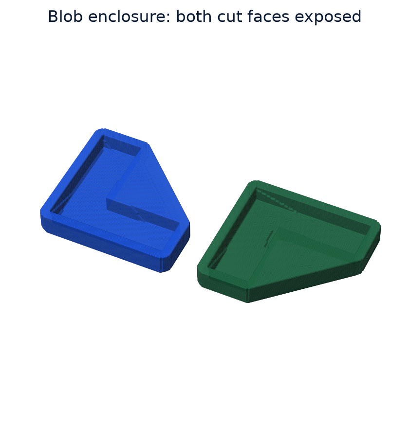

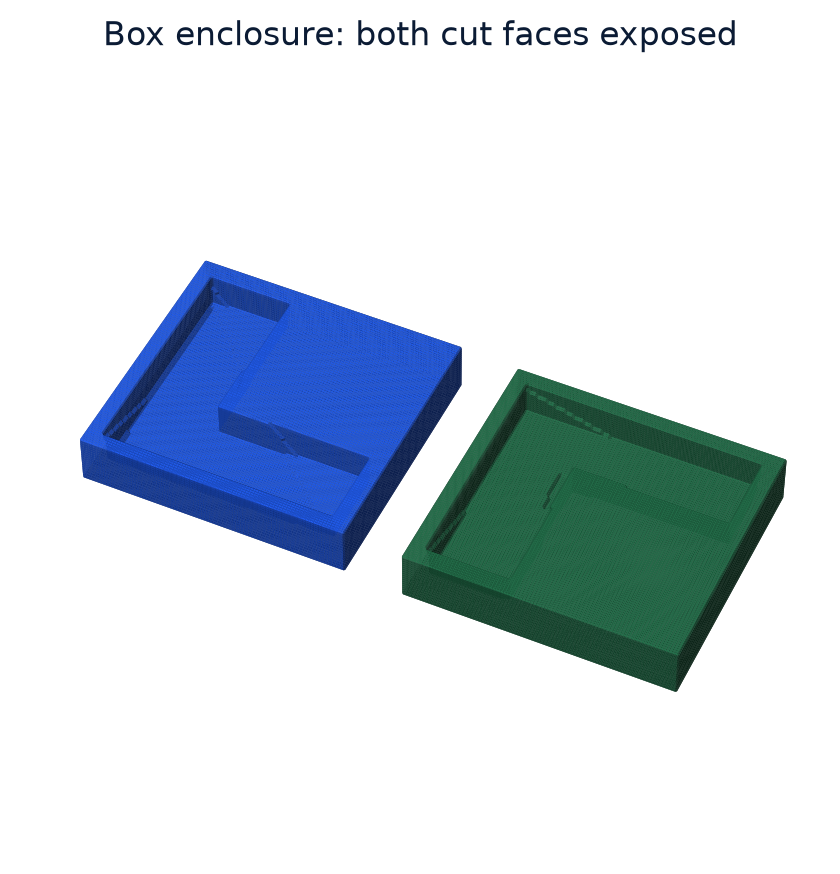

Treating enclosed islands separately from exterior-connected space removes unwanted pockets from the cavity construction. The operation follows the outside-skin enclosure objective: reserve the source-shaped space and build one body around it.

Keeping the largest connected material region removes detached fragments from the enclosing body. This completes the material construction before either the unsplit surface or the two halves are extracted.

## 6. Split the material, including its void

Each clamshell half needs its own closed boundary, including the cut face around the cavity opening. The split is applied to the material volume, so the cavity and surrounding walls are carried through the same operation.

$$
\pi(x)=(x-o)\cdot n,\qquad\varphi_{\pm}(x)=\max(\varphi_M(x),\mp\pi(x))
$$

| Symbol | Meaning |
| --- | --- |
| o,n | Split-plane origin and unit normal. |
| pi(x) | Signed side of a point. |
| phi_M | Sampled material field, negative in material and positive outside. |
| phi_plus,phi_minus | Intersections with the two half-spaces. |
| x | Position where the material and plane fields are evaluated. |
| max | Intersection of the negative-inside material field with each half-space. |

The plane expression says which side of the cut contains a point. The maximum keeps material only where both conditions hold: the point belongs to the existing material, and it lies on the chosen side. Because the cavity was already excluded from material, it is excluded from both halves as well.

The implementation assigns material-field values of minus or plus half a grid step and extracts the zero surface after the maximum operation. Both halves inherit the cavity because that space has already been excluded from material. Each extracted half then passes cleanup and closure validation.

The split returns two closed meshes. A rigid translation can separate them for inspection or export, as shown in the figures. That placement step changes their positions while preserving their shapes and the clearance inside each cavity.

The zero surface is interpolated from the sampled field. This accounts for the small volume difference between separately extracted unsplit material and the sum of the split halves. The comparison below measures that change directly.

## 7. Controlled output checks

These checks isolate construction rather than mixing it with subsequent reduction. Each half is checked for open edges, and its enclosed volume is measured. The sum of the two volumes is then compared with an independently extracted unsplit body made using the same construction settings.

| Outer body | Half face counts | Open edges | Build seconds | Split volume change |
| --- | --- | --- | --- | --- |
| Blob | 58,632 / 59,212 | 0 / 0 | 1.24 | -0.176% |
| Box | 64,840 / 65,360 | 0 / 0 | 1.37 | -0.175% |

The fixture used 0.5 mm requested offset, 2 mm wall, zero bridging, 0.35 mm pitch, and a horizontal split. Both shapes returned two closed halves. Compared with separately extracted unsplit material, combined split volume decreased by about 0.18 percent. The field interpolation therefore should not be described as lossless assembly. Timings cover the CPU cast construction; source completion and subsequent reduction are separate stages.

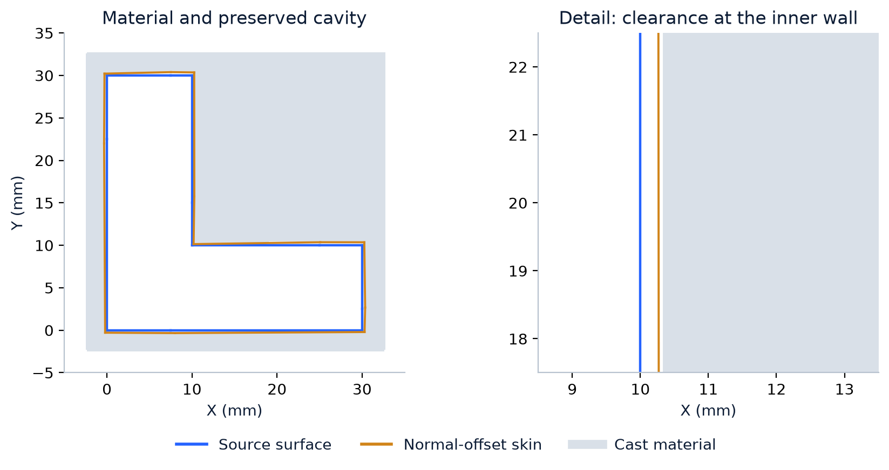

The table reports unreduced grid-extracted outputs. Subsequent QEM reduction is a separate workflow stage. Isolating construction here makes the effect of the cavity and split operations visible in the measurements.

The results connect the stages: edge counts describe the closed halves, clearance rays describe the cavity spacing, and the volume comparison describes the sampled split. Together they show what geometry the construction produced.

## 8. Cavity geometry and downstream use

The source-shaped cavity is visible directly in the geometry views below. Density coloring shows surface variation; wireframe exposes the triangles forming the same walls and recesses. These are display modes of the generated mesh, not a dimensional-error heatmap.

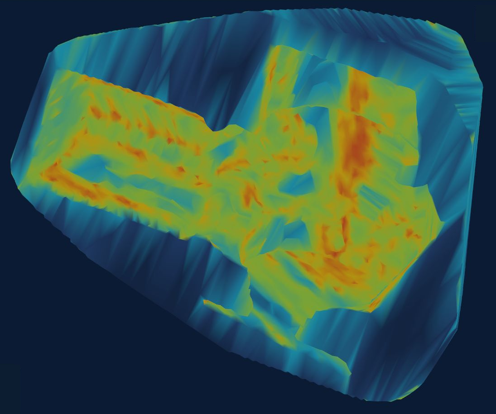

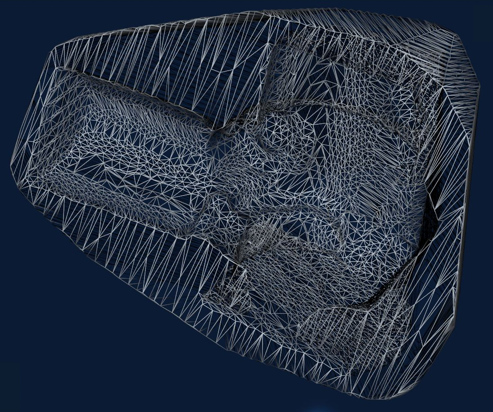

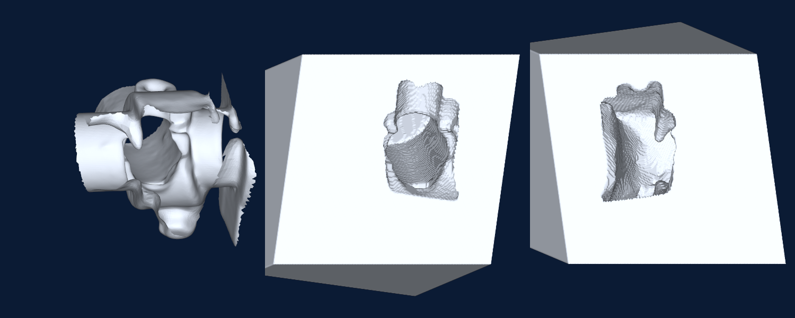

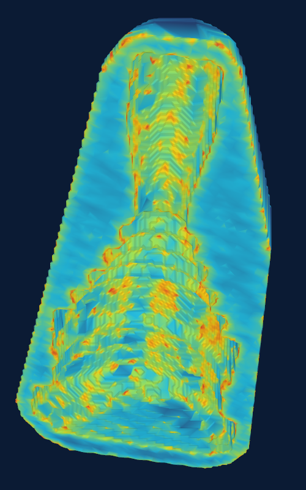

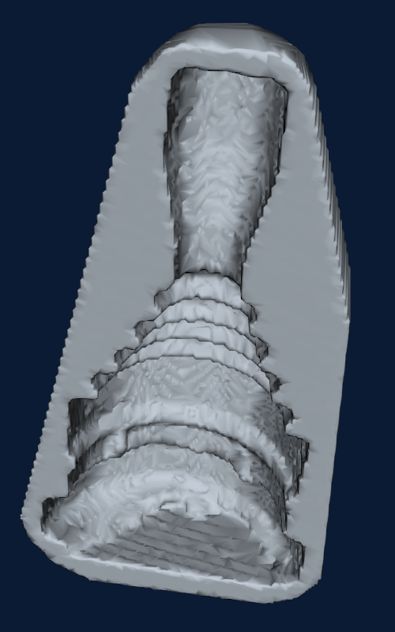

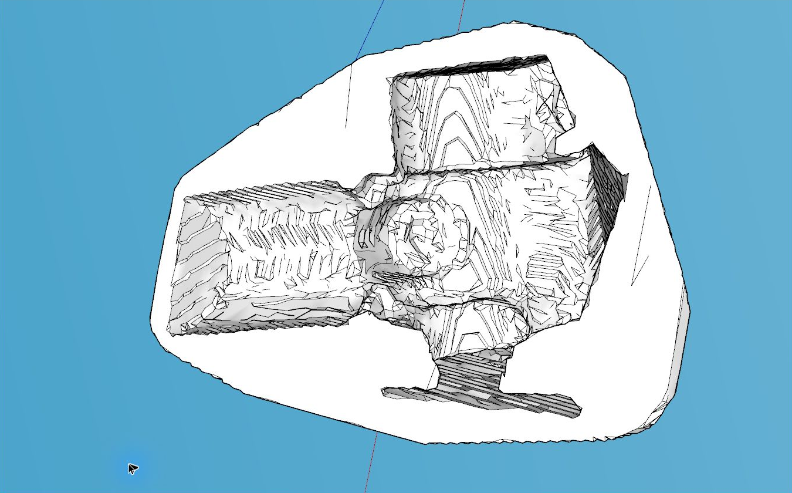

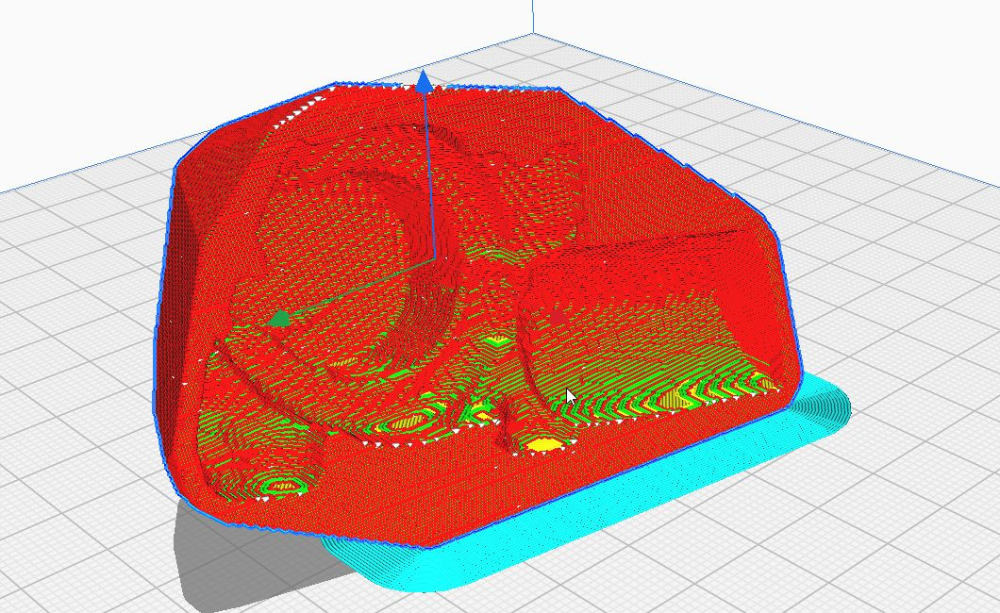

## 9. What the construction achieved

The construction produced two closed halves around the tested concave source, with the cavity visible in cross-section and in the exposed cut faces. Blob and Box used the same prepared source while producing different outer bodies.

The measured clearance follows from averaged-normal displacement and grid extraction. The approximately 0.18 percent split-volume change follows from interpolating the sampled half-fields. These measurements explain the output of the implemented process.

## References and implementation roles

- [VTK Flying Edges](https://vtk.org/doc/nightly/html/classvtkFlyingEdges3D.html): Incorporated sampled isosurface extraction; credited algorithm by Schroeder, Maynard and Geveci.
- [VTK hull and morphology](https://vtk.org/): Incorporated enclosing priors and image operations.
- [Surface-preserving completion](../solid-completion/paper.md): Companion account of constrained volume preparation, measured-facet retention, and boundary repair.
