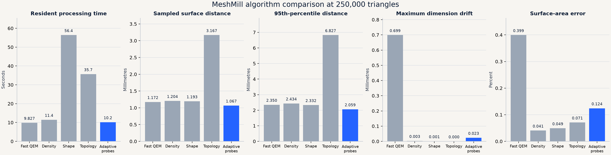
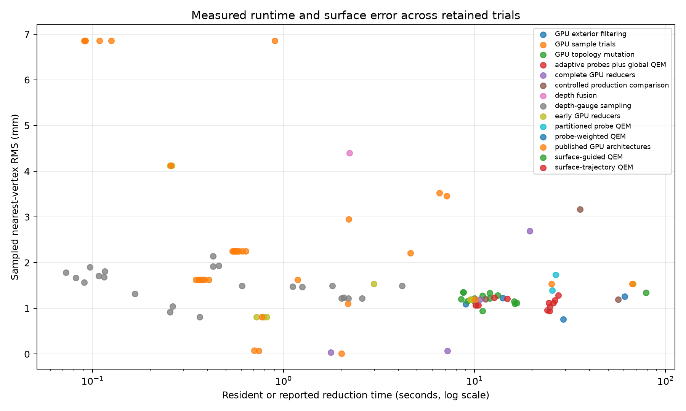
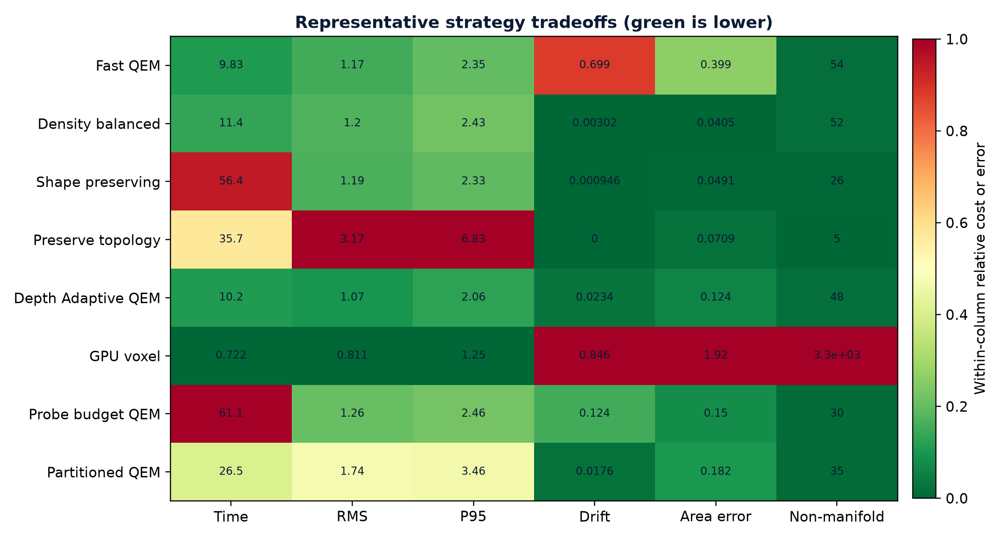

# Density-Balanced QEM in MeshMill

**Publisher:** Make Your Own World 
**Version:** 1.0

## Abstract

Density-aware mesh simplification is an established research direction. MeshMill did not originate the general idea of using local sampling density to guide simplification. This report documents how that idea was adapted into the application's Density balanced mode, how the implementation was measured, and how its strengths and limitations led to Depth Adaptive QEM and Depth + Density Adaptive QEM.

The MeshMill implementation estimates robust local sampling density from triangle incidence and surface area, normalizes the signal in log space, and supplies it to an attribute-aware quadric reduction path. On the 4,126,315-triangle composite scan used throughout the project, Density balanced reduced the mesh to 249,999 triangles in 11.51 seconds. It preserved axis-aligned dimensions substantially better than Fast QEM, but its RMS and P95 surface-distance measurements were slightly worse. The result established density as useful evidence, not as a sufficient geometric objective by itself.

*Figure 1. Matched production comparison from the earlier study. Density balanced is strongest in dimension preservation among the two CPU baselines, while depth-guided methods improve sampled surface distance.*

## 1. Scope and attribution

The established foundation is quadric error metric simplification and its attribute-aware extensions. Research and implementations predating MeshMill show that geometric and attribute signals can be incorporated into simplification objectives. MeshMill's contribution is the application-specific density estimator, robust normalization, integration into a practical scan-reduction workflow, measurement against the same source and target used by the other reducers, and the later use of density as one input to depth-guided surface correction.

The distinction is important:

- Local-density-aware reduction is established prior work.
- The Density balanced mode documented here is MeshMill's implementation and adaptation of that family of ideas.
- Depth Adaptive QEM and Depth + Density Adaptive QEM are later project-specific methods derived from the measured gaps in the density-only path.

## 2. Density estimator

For vertex $i$, let $c_i$ be the number of incident triangle corners and let $A_i$ be one third of the summed area of its incident triangles. The raw density proxy is

$$
\rho_i=\frac{c_i}{\max(A_i,\varepsilon)}.
$$

$\rho_i$ increases when more mesh samples occupy the same local surface area. The logarithm converts multiplicative density changes into additive differences:

$$
\ell_i=\log(\max(\rho_i,\varepsilon)).
$$

Let $m$ be the median of valid $\ell_i$ values and let the robust scale be

$$
s=1.4826\,\mathrm{median}(|\ell_i-m|)+\varepsilon.
$$

The normalized density signal is

$$
z_i=\mathrm{clip}\left(\frac{\ell_i-m}{s},-4,4\right).
$$

- $c_i$: incident triangle-corner count at vertex $i$.
- $A_i$: incident surface area assigned to vertex $i$.
- $\varepsilon$: small positive value that prevents division by zero.
- $\rho_i$: local samples per unit surface area.
- $m$: median log density.
- $s$: median-absolute-deviation scale.
- $z_i$: robust normalized density.

Median and median absolute deviation reduce the influence of isolated scan artifacts. Clipping prevents a small number of extreme regions from controlling the full optimization range.

## 3. Attribute-aware QEM integration

For geometric plane quadric $Q_i$ and candidate homogeneous position $\bar{\mathbf v}$, the standard geometric term is

$$
E_g(\bar{\mathbf v})=\bar{\mathbf v}^{T}(Q_i+Q_j)\bar{\mathbf v}.
$$

The density-aware path treats normalized density as an additional scalar attribute. In general form, the collapse objective becomes

$$
E=E_g+\lambda_\rho E_\rho,
\qquad
E_\rho=(z_i-z_j)^2.
$$

- $E_g$: accumulated geometric plane error.
- $E_\rho$: local density disagreement across the candidate edge.
- $\lambda_\rho$: density-attribute weight.
- $z_i,z_j$: robust density values at the edge endpoints.

This favors collapses within similarly sampled regions and resists crossing abrupt density changes. It does not determine whether a dense patch represents shape, dust, overlap, or redundant acquisition samples. That ambiguity explains the measured limitation.

## 4. Measured result

The controlled source contains 4,126,315 triangles and 2,070,061 vertices. Every row targets 250,000 triangles. Distance values below are percentages of the source bounding-box diagonal.

| Algorithm | Time (s) | Triangles | Reduction (%) | RMS (%) | P95 (%) | Drift (%) | Area (%) |
|---|---:|---:|---:|---:|---:|---:|---:|
| Fast QEM | 10.68 | 249,999 | 93.9413 | 0.115874 | 0.233072 | 0.067870 | 0.039930 |
| **Density balanced** | **11.51** | **249,999** | **93.9413** | **0.116976** | **0.236472** | **0.000294** | **0.040546** |
| Depth Adaptive QEM | 10.76 | 249,999 | 93.9413 | 0.103645 | 0.199997 | 0.002270 | 0.012410 |
| Depth + Density Adaptive QEM | 13.65 | 249,919 | 93.9433 | 0.103340 | 0.199314 | 0.0000015 | 0.0000106 |

Density balanced added 0.83 seconds over Fast QEM and reduced dimension drift by more than two orders of magnitude in this test. Its RMS error increased by about 0.95% relative to Fast QEM and its P95 error increased by about 1.46%. The outcome shows that density preservation and surface-shape preservation are related but distinct objectives.

*Figure 2. Runtime and sampled RMS error across the retained experiment families.*

*Figure 3. Target completion distinguishes practical reducers from fast preprocessing experiments that did not finish the reduction.*

## 5. What density did well

- Preserved the source bounding-box dimensions reliably on the controlled scan.
- Exposed oversampled regions that shaded rendering concealed.
- Added little runtime relative to the Fast QEM baseline.
- Supplied a stable statistical signal that could later modulate depth projection.
- Reached the requested target without introducing a separate GPU runtime requirement.

## 6. What density alone did not solve

High density does not imply important shape. A flat patch covered by dust, duplicated layers, or scanner noise can be extremely dense while contributing little to the intended surface. Conversely, a sparse region can contain an important edge. A density-only attribute therefore preserves the sampling pattern more faithfully without necessarily preserving the physical surface more accurately.

The result motivated a separation of responsibilities. Depth probes estimate the surface trajectory. Density controls how strongly that evidence affects locally oversampled regions. QEM performs topology reduction. Bounded finishing restores global dimensions, area, and edge incidence.

*Figure 4. Strategy-level tradeoffs recorded during the broader reduction study.*

## 7. Relationship to the combined method

Depth + Density Adaptive QEM does not place density into the global topology queue used by the slower attribute-QEM prototype. It computes robust density during the parallel surface-analysis stage and uses a bounded gain to scale the depth correction:

$$
g_i=g_{\min}+\frac{g_{\max}-g_{\min}}
{1+\exp[-\beta(z_i-z_0)]}.
$$

$$
\mathbf v_i'=\mathbf v_i+g_i\Delta_i\mathbf n_i.
$$

- $g_i$: bounded density gain.
- $g_{\min},g_{\max}$: lower and upper gain limits.
- $\beta$: transition slope.
- $z_0$: robust-density transition center.
- $\Delta_i$: depth-derived signed displacement.
- $\mathbf n_i$: vertex normal.

This preserves the useful density signal while avoiding the 74.68-second attribute-aware topology bottleneck measured in the first combined prototype.

## 8. Why GPU voxel clustering was not used as a preprocessing shortcut

GPU voxel clustering maps each vertex to an integer cell and replaces every occupied cell with one representative:

$$
\mathbf k(\mathbf v)=\left\lfloor\frac{\mathbf v-\mathbf b}{h}\right\rfloor,
\qquad
\mathbf r_{\mathbf k}=\frac{1}{|C_{\mathbf k}|}
\sum_{\mathbf v_i\in C_{\mathbf k}}\mathbf v_i.
$$

- $h$: voxel width.
- $\mathbf b$: lower mesh bound.
- $C_{\mathbf k}$: source vertices assigned to voxel $\mathbf k$.
- $\mathbf r_{\mathbf k}$: replacement vertex.

The operation is fast because cells are independent. It also reduces representational entropy by discarding every distinction within a cell. For source state $V$, voxel key $K$, and any later operation $g$,

$$
I(V;g(K))\le I(V;K)\le H(K)\le H(V).
$$

Once disconnected layers share a key, a later density estimator cannot determine which samples belonged to which surface. Density balanced can redistribute simplification pressure, but it cannot invert a many-to-one clustering map or reconstruct removed adjacency.

The measured GPU voxel output took 0.72 seconds and reached 243,813 triangles. Its 0.8105 mm RMS and 1.2489 mm P95 were locally attractive, but the output also contained 3,297 non-manifold edges, 0.8465 mm dimension drift, and 1.9215% surface-area error. Density balanced took 11.44 seconds and retained the ordered QEM topology path, producing 52 non-manifold edges, 0.00302 mm drift, and 0.0405% area error. The methods optimize different objectives: voxel clustering minimizes independent spatial representation, while Density balanced tries to preserve a usable connected surface under reduction.

Voxel clustering can still support previews, coarse spatial indexing, and out-of-core scheduling. It was not used ahead of precision reduction because the discarded layer and connectivity information is exactly what the later method needs to preserve.

## 9. Limitations

- The numerical comparison covers one deliberately difficult composite scan.
- Local incidence per surface area is a proxy for sampling density, not a semantic classifier.
- Bounding-box drift measures three global axes and does not prove local dimensional accuracy.
- Nearest-surface RMS and P95 are sampled approximations.
- The implementation inherits the behavior and constraints of its QEM backend.

## 10. Prior work and implementation sources

- Michael Garland and Paul S. Heckbert, "Surface Simplification Using Quadric Error Metrics," SIGGRAPH 1997. <https://www.mgarland.org/research/quadrics.html>
- Michael Garland and Paul S. Heckbert, "Simplifying Surfaces with Color and Texture using Quadric Error Metrics," IEEE Visualization 1998. <https://www.mgarland.org/research/quadrics.html>
- Carlos DeCoro and Peter Lindstrom, "Real-time Mesh Simplification Using the GPU," 2007. <https://gfx.cs.princeton.edu/gfx/pubs/DeCoro_2007_RMS/real_time_simplification.pdf>
- Thomas M. Cover and Joy A. Thomas, *Elements of Information Theory*, second edition, Wiley, 2006. The data-processing inequality provides the formal limit on recovering source distinctions after many-to-one clustering.
- VTK, `vtkQuadricDecimation` class reference. <https://vtk.org/doc/nightly/html/classvtkQuadricDecimation.html>
- R statistical documentation, "Median Absolute Deviation." <https://web.mit.edu/R/current/lib/R/library/stats/html/mad.html>

## 11. Conclusion

Density balanced was a useful intermediate production algorithm. It showed that robust local sampling density could improve dimensional stability with little runtime cost, while the matched surface-distance measurements showed why density alone was insufficient. Those findings were carried forward into the depth-guided combined method, where density controls a bounded surface correction instead of burdening the topology reducer.

## Independent Research, Related Work, and Attribution

The purpose of this project is to explore ideas, solve problems, document what we learn, and make useful work available for others to build upon.

Our work may involve original developments, improvements to established methods, independent rediscovery, or approaches that overlap with existing research and projects. We consider all of these worthwhile contributions. Novelty, priority, and recognition are not prerequisites for useful work.

We recognize that virtually all research and development builds upon generations of work by others. We make a good-faith effort to identify and acknowledge relevant publications, projects, tools, and contributors, and to respect applicable licenses and attribution requirements.

Some related work may only become known after research or development has already taken place. Being cited as related work does not necessarily mean that it influenced or was used in the original implementation. Where external work is directly incorporated or adapted, we aim to identify and credit it appropriately.

No individual or project can reasonably guarantee awareness of every related idea, publication, implementation, or independent discovery. References and acknowledgments therefore reflect the information available at the time and may be expanded or corrected as additional work comes to our attention.

We do not claim exclusive ownership of general ideas, methods, or discoveries, nor do we assume that independent development establishes historical priority. Similarity or overlap should not, by itself, be interpreted as evidence of copying or misappropriation.

We welcome constructive corrections, additional references, and contributions that improve the accuracy and usefulness of the published record. Our focus is on the work itself and the knowledge it makes available, rather than disputes over recognition or precedence.

**Whether something is new, familiar, independently rediscovered, or simply useful, our goal is the same: preserve what was learned, share it openly, and help others move forward.**
