# Depth + Density Adaptive QEM: Fast Density-Guided Surface Reduction

**Publisher:** Make Your Own World 
**Version:** 1.1

## Abstract

Dense meshes mix useful surface shape with the sampling pattern and acquisition noise used to record it. Quadric error metric (QEM) reduction preserves accumulated plane error, but it does not identify redundant scan density or guarantee preservation of dimensions, surface area, and edge incidence. Depth Adaptive QEM addressed the surface-signal problem with GPU-parallel, multiscale depth-gauge probes before CPU topology reduction. This work adds robust sampling-density evidence and bounded finishing.

The first complete hybrid placed density and normal attributes inside VTK's extended QEM objective. It achieved the best sampled local error, but required 80.88 seconds because its global attribute-aware topology pass consumed 74.68 seconds. Several attempted shortcuts either weakened surface quality or retained the same serial bottleneck. The final production method instead applies robust density during the GPU depth projection, performs one boundary-preserving Fast QEM pass, removes only non-manifold surplus faces, and restores area and axis-aligned dimensions with bounded corrections.

On a 4,126,315-triangle composite scan reduced to approximately 250,000 triangles, the production method required 13.65 seconds. It produced RMS distance of 0.103340% of the source diagonal, P95 distance of 0.199314%, maximum dimension drift of 0.0000015%, surface-area error of 0.0000106%, and no measured non-manifold edges. This is 5.92 times faster than the first attribute-QEM hybrid while retaining its global and topological corrections. The slower design remains a useful quality reference rather than the production implementation.

## Comparative result

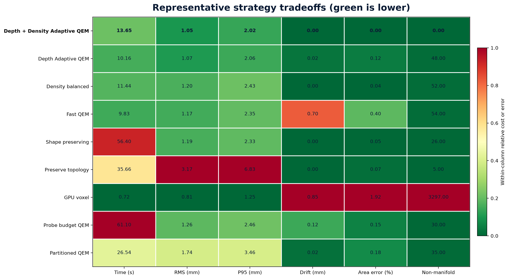

*Figure 1. The earlier strategy heatmap extended with Depth + Density Adaptive QEM. Every row uses the same source and approximately 250,000-triangle target. The original chart's linear per-column color scales are preserved, so every previous row keeps its earlier color. The new row is evaluated against those fixed ranges. Green represents the old column minimum or a new result below it; red represents the old column maximum or a new result above it. Printed values are the underlying measurements.*

The sequence explains why the combined method exists. Fast QEM established the runtime baseline. Density balanced produced the lowest dimension drift of the two CPU baselines and showed that sampling density contains useful evidence, but it did not improve sampled RMS or P95 error on this fixture. Depth Adaptive QEM improved the local surface measurements substantially, although its finishing left more dimension and area error than density balanced. Depth + Density Adaptive QEM combines robust density evidence with depth-gauge surface projection, then applies bounded dimension, area, and topology finishing. It produced the best measured result among the production algorithms in RMS, P95, dimension drift, area preservation, and excess edge incidence. Runtime increased by 2.97 seconds over Fast QEM while the mesh still fell from 4,126,315 to 249,919 triangles, a 93.9433% reduction.

## 1. Problem and evaluation vector

Let the source triangle mesh be $M=(V,F)$, where $V=\{\mathbf v_i\}_{i=1}^{n}$ contains vertices and $F$ contains indexed triangular faces. Given target face count $N<|F|$, simplification seeks $M'=(V',F')$ with approximately $N$ faces while preserving the observable source surface.

$$
\mathbf q(M,M')=
\left[D_{\mathrm{RMS}},D_{95},E_{\mathrm{dim}},E_A,E_{\mathrm{topo}},T\right].
$$

- $D_{\mathrm{RMS}}$: normalized sampled root-mean-square surface distance.
- $D_{95}$: normalized 95th-percentile sampled surface distance.
- $E_{\mathrm{dim}}$: maximum axis-aligned dimension drift.
- $E_A$: relative surface-area error.
- $E_{\mathrm{topo}}$: rate of output edges incident on more than two faces.
- $T$: end-to-end algorithm runtime after source loading.

Let $B$ be the source bounding-box diagonal. For sampled source points $\mathbf x_s$ and nearest points $\mathbf y_s$ on $M'$,

$$
D_{\mathrm{RMS}}=
\frac{100}{B}\sqrt{\frac{1}{S}\sum_{s=1}^{S}
\left\lVert\mathbf x_s-\mathbf y_s\right\rVert^2},
$$

$$
D_{95}=\frac{100}{B}Q_{0.95}
\left(\left\lVert\mathbf x_s-\mathbf y_s\right\rVert\right).
$$

$S$ is the sample count and $Q_{0.95}$ is the empirical 95th percentile. For axis $a\in\{x,y,z\}$,

$$
L_a(M)=\max_{\mathbf v\in V}v_a-\min_{\mathbf v\in V}v_a,
$$

$$
E_{\mathrm{dim}}=\frac{100}{B}
\max_{a\in\{x,y,z\}}\left|L_a(M')-L_a(M)\right|.
$$

For face $f=(i,j,k)$,

$$
A_f=\frac{1}{2}\left\lVert
(\mathbf v_j-\mathbf v_i)\times(\mathbf v_k-\mathbf v_i)
\right\rVert,
$$

$$
A(M)=\sum_{f\in F}A_f,
\qquad E_A=100\frac{|A(M')-A(M)|}{A(M)}.
$$

If $k(e)$ is the output-face incidence count for edge $e$,

$$
E_{\mathrm{topo}}=100\frac{|\{e:k(e)>2\}|}{|E'|}.
$$

This topology statistic does not prove watertightness or orientability. It measures one specific failure observed during reduction.

## 2. QEM and the topology bottleneck

For normalized plane $p=[a,b,c,d]^T$, its quadric is $K_p=pp^T$. The quadric accumulated at vertex $i$ is

$$
Q_i=\sum_{p\in\mathcal P(i)}K_p.
$$

For candidate homogeneous position $\bar{\mathbf v}=[x,y,z,1]^T$, geometric collapse error is

$$
E_g(\bar{\mathbf v})=
\bar{\mathbf v}^{T}(Q_i+Q_j)\bar{\mathbf v}.
$$

An accepted collapse changes faces, adjacency, quadrics, and neighboring candidate costs. If $C_t$ is the collapse accepted at step $t$, then

$$
\mathcal C_{t+1}=U(\mathcal C_t,C_t).
$$

$\mathcal C_t$ is the candidate set and $U$ is the topology and priority update. This dependency graph explains the measured split: independent face and cell measurements parallelize efficiently on the GPU, while a conventional global QEM queue spends most of its time mutating topology and repairing priorities.

## 3. GPU depth-gauge surface analysis

The source sampling scale is the median valid edge length:

$$
d=\mathrm{median}\left(\left\{
\left\lVert\mathbf v_i-\mathbf v_j\right\rVert:(i,j)\in E
\right\}\right).
$$

$d$ is the virtual probe diameter and $r=d/2$ is its rounded-tip radius. If $N$ equal-area equilateral triangles represented the same source area, their characteristic edge length would be

$$
p_o=\sqrt{\frac{4A(M)}{\sqrt{3}N}}.
$$

The finest probe pitch and multiscale hierarchy are

$$
p_{\min}=\max(d,p_o),
\qquad \mathcal P=\{8p_{\min},4p_{\min},2p_{\min},p_{\min}\}.
$$

For cell $c$, area-weighted center and unit normal are

$$
\mathbf o_c=\frac{\sum_{f\in c}A_f\mathbf c_f}{\sum_{f\in c}A_f},
$$

$$
\mathbf n_c=\frac{\sum_{f\in c}A_f\mathbf n_f}
{\left\lVert\sum_{f\in c}A_f\mathbf n_f\right\rVert}.
$$

$\mathbf c_f$ and $\mathbf n_f$ are face center and unit normal. Cell coherence and face residual are

$$
h_c=\frac{\left\lVert\sum_{f\in c}A_f\mathbf n_f\right\rVert}
{\sum_{f\in c}A_f},
$$

$$
e_f=\left|\mathbf n_c\cdot(\mathbf c_f-\mathbf o_c)\right|.
$$

Cells that fail coherence or residual tests continue at a finer pitch. Unresolved faces remain unchanged. For a supported excursion, the signed displacement along the local trajectory is

$$
\delta_f=-\mathbf n_c\cdot(\mathbf c_f-\mathbf o_c).
$$

Area-weighted incident-face contributions form raw vertex displacement $\boldsymbol\Delta_i$.

## 4. Robust density and the final projection formula

Local incident sampling density is

$$
\rho_i=\frac{|F(i)|}{\sum_{f\in F(i)}A_f+\varepsilon}.
$$

$F(i)$ is the set of faces incident on vertex $i$. Log density, robust center, and scale are

$$
\ell_i=\ln(\max(\rho_i,\varepsilon)),
\qquad m=\mathrm{median}(\ell_i),
$$

$$
\sigma_r=\max\left(
1.4826\mathrm{median}(|\ell_i-m|),\varepsilon
\right),
\qquad z_i=\frac{\ell_i-m}{\sigma_r}.
$$

The factor $1.4826$ makes median absolute deviation comparable to standard deviation for a normal distribution. The production density gain is

$$
g_i=g_{\min}+\frac{g_{\max}-g_{\min}}
{1+\exp[-\beta(z_i-z_0)]},
$$

with

$$
g_{\min}=1.0,
\qquad g_{\max}=1.5,
\qquad z_0=0.25,
\qquad \beta=1.5.
$$

Dense regions contain stronger evidence for the fitted local surface, so they receive more of the supported depth correction. Sparse regions remain near the measured source. The final projected displacement is

$$
\boldsymbol\Delta_i'=
g_i\boldsymbol\Delta_i
\min\left(
1,
\frac{r}{4\left\lVert g_i\boldsymbol\Delta_i\right\rVert}
\right).
$$

The physical cap prevents density from authorizing an arbitrarily large geometric change.

## 5. Failed and superseded designs

### 5.1 Attenuating depth correction

The first density experiment multiplied depth displacement by a density gate after trajectory inference:

$$
\boldsymbol\Delta_i^{\mathrm{gate}}=g(z_i)\boldsymbol\Delta_i.
$$

Tested variants produced RMS of approximately 0.1193% to 0.1198% and P95 of 0.2429% to 0.2449%, worse than Depth Adaptive QEM at 0.103645% and 0.199997%. The gate suppressed useful correction without improving topology selection.

### 5.2 Global attribute-aware QEM

The first complete hybrid placed normalized density $s_i=(\mathrm{clip}(z_i,-4,4)+4)/8$ and area-weighted normals into an extended objective:

$$
E_{\mathrm{attr}}=E_g+\lambda_{\rho}E_{\rho}+\lambda_nE_n,
$$

with $\lambda_{\rho}=0.15$ and $\lambda_n=0.10$. The design achieved RMS 0.096901% and P95 0.174545% after finishing. Its runtime was unacceptable for an interactive application:

| Stage | Time (s) | Share |
|---|---:|---:|
| GPU depth analysis | 0.90 | 1.1% |
| Density and normal features | 2.06 | 2.6% |
| VTK attribute-aware QEM | 74.68 | 92.3% |
| Bounded finishing | 3.21 | 4.0% |
| **Total** | **80.88** | **100%** |

The GPU work was already inexpensive. The regression came from substituting a much slower global topology engine, not from computing density or transferring geometry.

### 5.3 Stronger attributes, volume, and boundaries

At $\lambda_{\rho}=10$, drift reached 0.067831% and area error reached 0.746993%. A strong normal term worsened sampled shape error. Volume preservation was poorly matched to an open, layered source. A strong boundary penalty preserved acquisition holes and redundant layer boundaries along with useful outlines.

### 5.4 Staged and partitioned reduction

Two-pass Fast QEM variants at intermediate targets of 500,000 and 1,000,000 triangles completed in approximately 13.8 to 16.3 seconds, but worsened RMS to 0.1313% to 0.1560% and P95 to 0.2695% to 0.3284%. Spatial partitioning introduced boundary reconciliation and seam problems.

### 5.5 Native density-weighted Fast QEM prototype

A prototype added an edge-local density penalty to the fast reducer:

$$
E_{ij}^{\mathrm{fast}}=E_g+p_o^2\lambda_{\rho}(s_i-s_j)^2.
$$

$p_o^2$ converts the dimensionless density difference to the geometric error scale. A normal-difference term was tested and removed because it consistently worsened RMS and P95. The best density-only prototype required 14.95 seconds and achieved RMS 0.097229% and P95 0.181799%, with negligible drift and area error after finishing. It was not selected as the portable production path because it required a separate modified native reducer and additional platform packaging. It remains a measured implementation candidate.

## 6. Final production algorithm

1. Derive physical probe diameter, tip radius, output pitch, and multiscale probe hierarchy.
2. Compute robust log density and sigmoid gain on the GPU.
3. Analyze coherent surface trajectories from coarse to fine probe pitch.
4. Apply density-scaled, physically capped projection only where the surface evidence passes the trajectory tests.
5. Run one boundary-preserving Fast QEM pass with aggressiveness 8.0.
6. Remove the smallest surplus faces around edges with more than two incident faces.
7. Restore the six source axis extrema.
8. Apply bounded one-ring relaxation, solved against source surface area while retaining the extrema.

$$
M\longrightarrow\widetilde M_{\rho}\longrightarrow M_q\longrightarrow M'.
$$

The arrows represent GPU probes and density, Fast QEM, and topology and invariant finishing, respectively.

## 7. Bounded finishing

For each output edge, the required surplus-face removal count is

$$
r(e)=\max(0,k(e)-2).
$$

The cleanup retains the two largest-area incident faces. For every axis $a$, extrema are then restored:

$$
v_{a,\min}'\leftarrow\min_{\mathbf v\in V}v_a,
\qquad v_{a,\max}'\leftarrow\max_{\mathbf v\in V}v_a.
$$

Only six scalar coordinates are constrained. Let $\mathbf m_i$ be the mean centroid of output faces incident on vertex $i$:

$$
\mathbf m_i=\frac{1}{|F'(i)|}\sum_{f\in F'(i)}\mathbf c_f.
$$

The relaxed position is

$$
\mathbf v_i(\alpha)=\mathbf v_i+\alpha(\mathbf m_i-\mathbf v_i),
\qquad 0\le\alpha\le0.08.
$$

A 12-iteration binary search selects the smallest bounded $\alpha$ that reaches the source surface area. Axis extrema are restored for every candidate.

## 8. Results

The source contains 4,126,315 triangles and 2,070,061 vertices. The target is 250,000 triangles. Distance metrics use 200,000 samples. Timings exclude source loading and connectivity preparation.

| Algorithm | Time (s) | Triangles | RMS (%) | P95 (%) | Drift (%) | Area (%) | Non-manifold (%) |
|---|---:|---:|---:|---:|---:|---:|---:|
| Fast QEM | 10.68 | 249,999 | 0.115874 | 0.233072 | 0.000519 | 0.046282 | 0.020800 |
| Density balanced | 11.51 | 249,999 | 0.116976 | 0.236472 | 0.000294 | 0.040546 | 0.020800 |
| Depth Adaptive QEM | 10.76 | 249,999 | 0.103645 | 0.199997 | 0.002270 | 0.124123 | 0.019200 |
| Attribute-QEM hybrid, superseded | 80.88 | 249,967 | 0.096901 | 0.174545 | 0.0000015 | 0.0000118 | 0.000000 |
| Native weighted prototype | 14.95 | 249,900 | 0.097229 | 0.181799 | 0.0000015 | 0.0000204 | 0.000000 |
| **Production Depth + Density Adaptive QEM** | **13.65** | **249,919** | **0.103340** | **0.199314** | **0.0000015** | **0.0000106** | **0.000000** |

Compared with Fast QEM, the production hybrid improved RMS by 10.8% and P95 by 14.5%, eliminated measured non-manifold edges, and reduced dimension and area error to the reporting floor. It cost 2.97 seconds, or 27.8%, more runtime. Compared with the superseded attribute-QEM hybrid, it was 5.92 times faster.

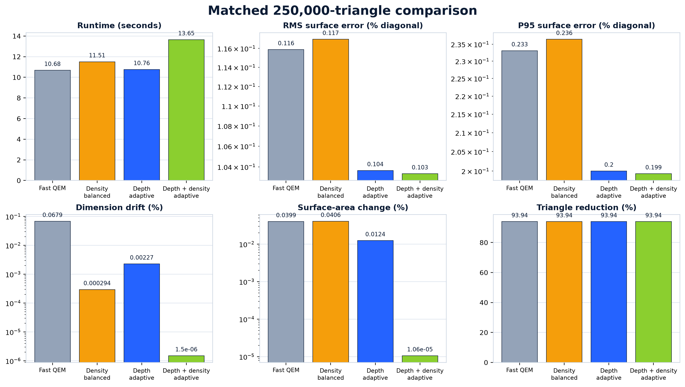

*Figure 2. Detailed matched comparison of the four production algorithms. Lower is better for runtime and error. Every method removes approximately 93.94% of the source triangles.*

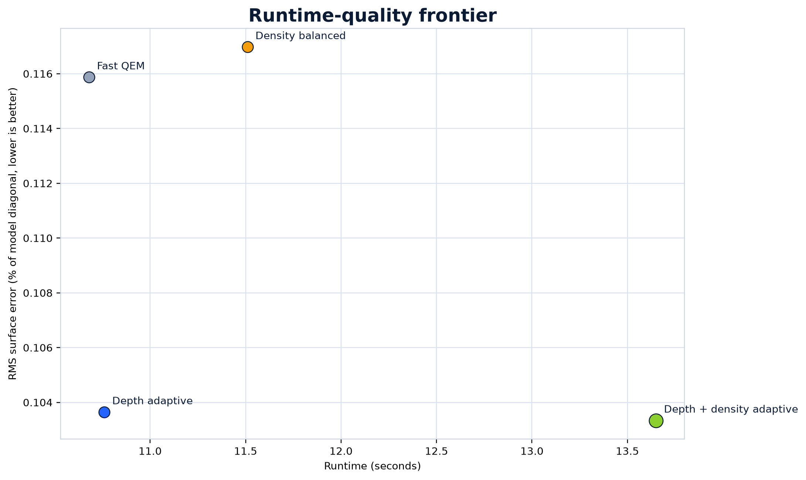

*Figure 3. The combined method moves the measured quality frontier while remaining in the interactive runtime range.*

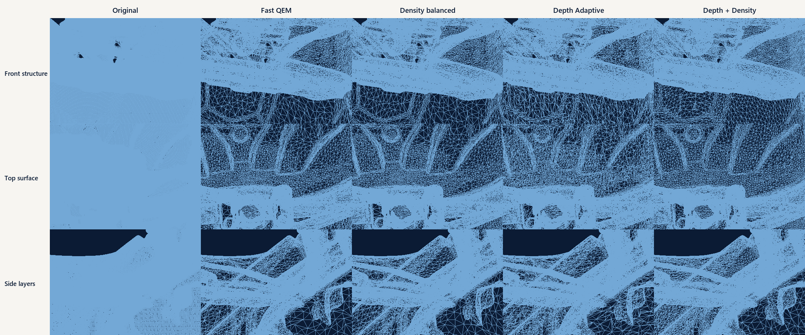

*Figure 4. Original and reduced outputs under the same wireframe view.*

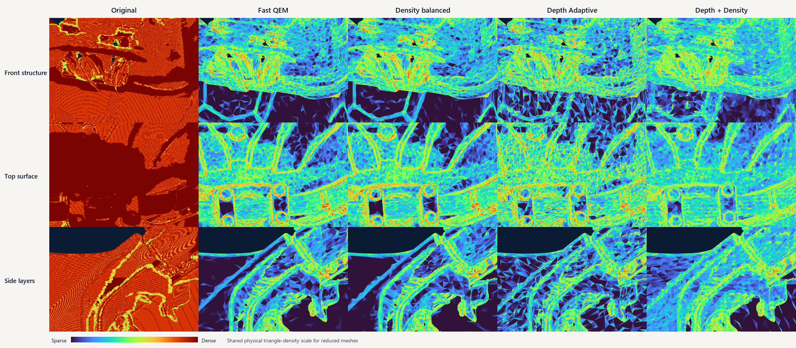

*Figure 5. Local point-density rendering reveals sampling redistribution hidden by shaded rendering.*

### Large-format comparison of the top three production methods

The following views use the same source bounds, orthographic camera, target count, lighting, and framing. Shaded views expose surface continuity and silhouette behavior. Wireframe views expose triangle allocation, open layers, and where a method spends its geometry budget.

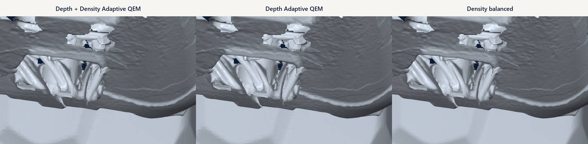

*Figure 6. Matched shaded front detail: Depth + Density Adaptive QEM, Depth Adaptive QEM, and Density balanced.*

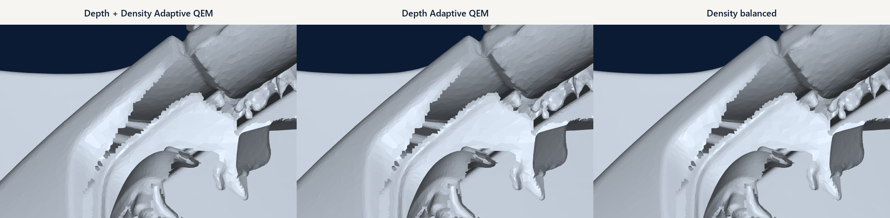

*Figure 7. Matched shaded side-layer detail. The larger panels make local surface continuity and thin-layer behavior directly comparable.*

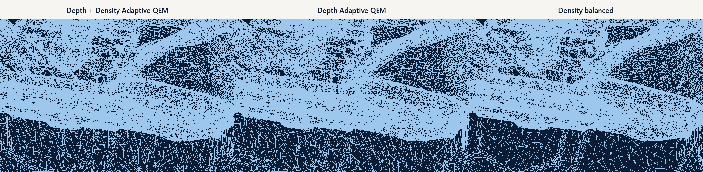

*Figure 8. Matched wireframe front detail. Triangle placement reveals where similar output counts preserve different structures.*

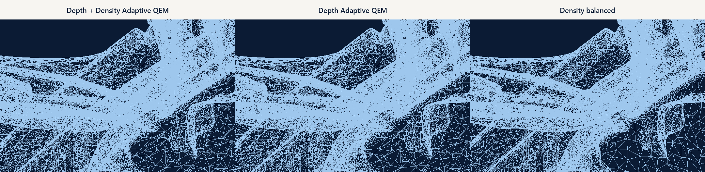

*Figure 9. Matched wireframe side-layer detail.*

## 9. Why GPU voxel clustering cannot be a precision prepass

GPU voxel clustering was retained as a measured comparison because it demonstrates real parallel speed. For voxel width $h$ and lower mesh bound $\mathbf b$, each source vertex receives an independent spatial key

$$
\mathbf k(\mathbf v)=\left\lfloor\frac{\mathbf v-\mathbf b}{h}\right\rfloor.
$$

Vertices sharing a key are replaced by one representative, commonly a centroid

$$
\mathbf r_{\mathbf k}=\frac{1}{|C_{\mathbf k}|}
\sum_{\mathbf v_i\in C_{\mathbf k}}\mathbf v_i.
$$

- $h$: voxel width.
- $\mathbf b$: lower mesh bound.
- $\mathbf k$: integer voxel address.
- $C_{\mathbf k}$: vertices assigned to that voxel.
- $\mathbf r_{\mathbf k}$: replacement vertex.

This operation reduces representational entropy by discarding within-cell identity. If $K$ is the voxel key of source vertex $V$, then deterministic clustering obeys the data-processing inequality:

$$
I(V;g(K))\le I(V;K)\le H(K)\le H(V).
$$

- $H(V)$: information represented by the source vertex state.
- $H(K)$: information retained by the voxel address.
- $I(V;K)$: mutual information between the source and its cluster key.
- $g(K)$: any later reducer operating only on clustered output.

The many-to-one map is deliberately destructive. Distinct vertices can satisfy $\mathbf k(\mathbf v_a)=\mathbf k(\mathbf v_b)$ even when they belong to separate sheets, opposing surfaces, or different scan layers. Once both become $\mathbf r_{\mathbf k}$, no later depth probe, density estimator, or QEM pass can recover which connectivity belonged to which source layer. Adding normal bins or quadric representatives improves the chosen point but does not restore the discarded identity or global collapse order.

The controlled GPU voxel trial completed in 0.72 seconds and produced 243,813 triangles, 0.8105 mm RMS, and 1.2489 mm P95. Those local distance values were attractive, but the same output had 0.8465 mm maximum dimension drift, 1.9215% surface-area error, and 3,297 non-manifold edges. The method was fast because each cell could be reduced independently. That independence was also the source of the topology damage.

Depth + Density Adaptive QEM has a different objective. It keeps source connectivity through surface inference, uses parallel probes and density only to estimate bounded corrections, and performs one globally ordered QEM reduction before invariant finishing. At the same approximate target it required 13.65 seconds, with 1.05 mm RMS, 2.02 mm P95, drift and area error rounding to 0.00 at two decimals, and zero measured non-manifold edges. Its local distance is not as low as the destructive voxel result, but it preserves the valid, editable mesh structure and global invariants that the application requires.

Placing voxel clustering before the high-precision path would therefore optimize the wrong stage. It would erase surface and layer distinctions before the precision method measured them. The two methods can share GPU infrastructure, spatial indexing, and parallel reductions, but their destructive and preservation objectives cannot be composed without changing the result being preserved.

## 10. Continuity with the earlier study

This work continues the broader Depth Adaptive QEM investigation rather than replacing its evidence. The earlier study retained GPU clustering, probe, projection, visibility, partitioning, topology, and production-baseline experiments. The following plots preserve that experiment landscape and place the combined method in the context that led to it.

*Figure 10. Earlier matched production comparison across Fast QEM, Density balanced, shape-preserving QEM, topology-preserving QEM, and Depth Adaptive QEM.*

*Figure 11. Retained trial families plotted by runtime and sampled RMS error. The plot shows why a fast analysis stage did not by itself create a usable reducer.*

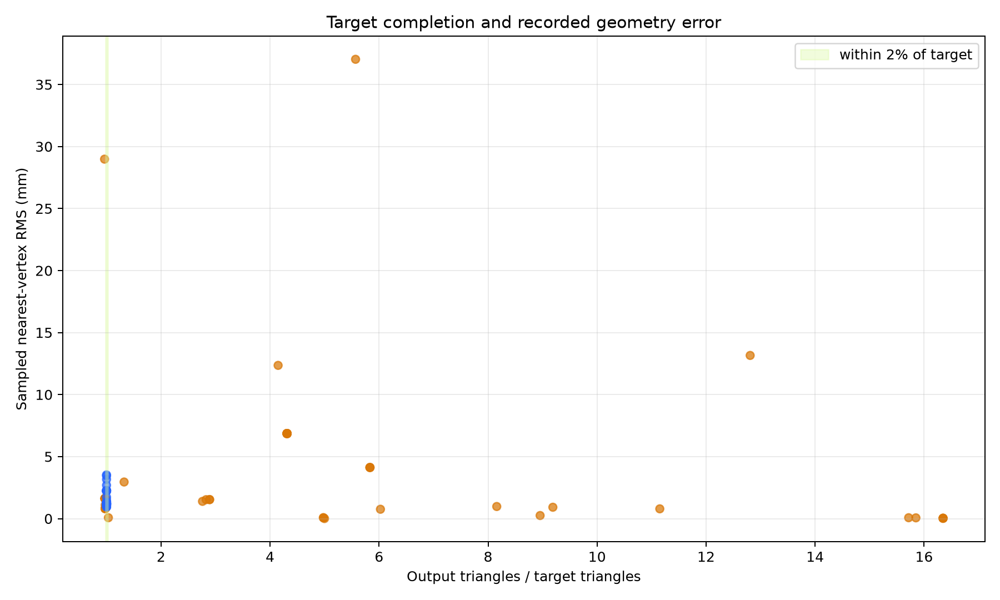

*Figure 12. Target completion exposes methods that appeared fast only because they failed to remove enough triangles.*

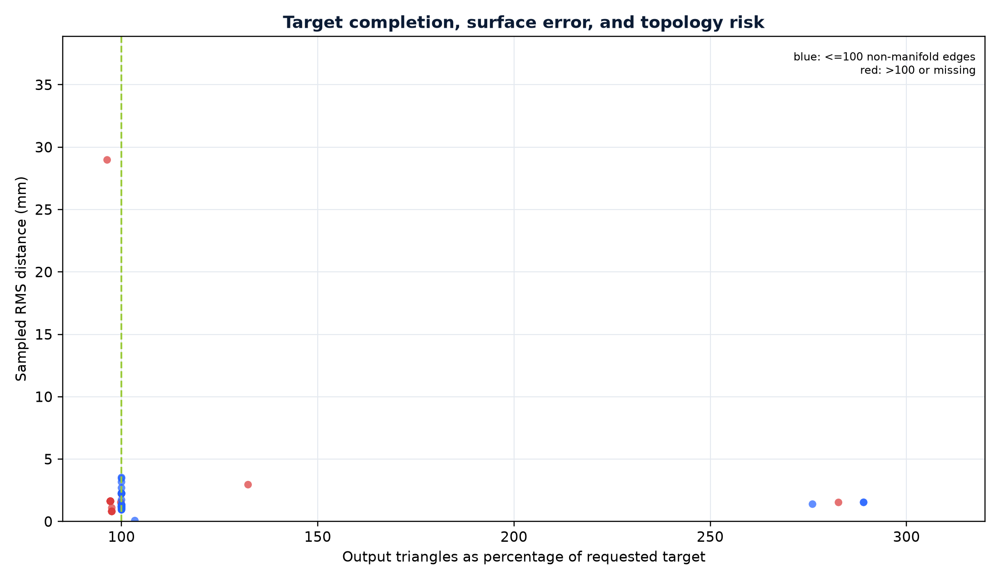

*Figure 13. Reduction completion and topology behavior across the retained experiment set.*

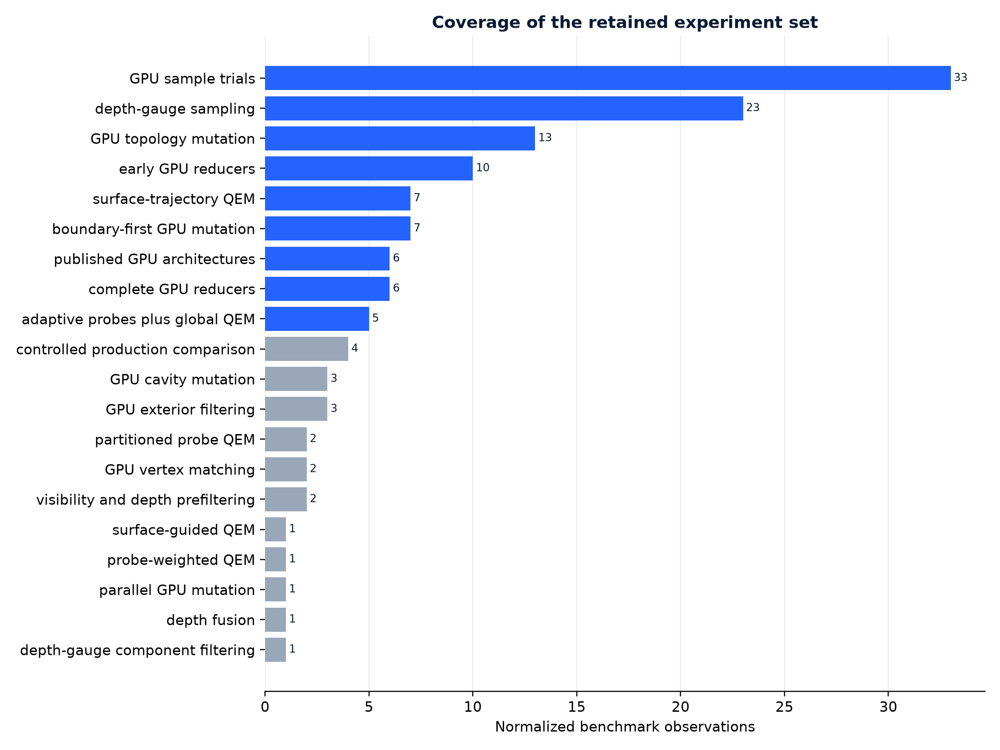

*Figure 14. Coverage of the recorded strategy families used to derive the production architecture.*

## 11. Runtime conclusions

The 80-second result did not show that combined depth-density analysis was expensive. The execution profile isolated the cost to replacing the established fast topology reducer with VTK's global attribute-aware reducer. GPU analysis remained near one second.

Geometry already resident for GPU analysis does not make a dependency-sensitive CPU topology queue parallel. More GPU arithmetic does not repair the synchronization and adjacency-update structure of conventional edge collapse. Density improved the fast pipeline when it modified independent surface inference, while the slower topology engine consumed the runtime advantage.

The production correction preserved the working stages and removed the measured bottleneck. It did not conceal the runtime with a lower target, omit finishing, or place the same work behind another process boundary.

## 12. Limitations

- Results cover one deliberately difficult composite scan.
- Nearest-surface sampling is an approximation.
- Exact extrema preserve axis-aligned dimensions, not arbitrary directional caliper dimensions.
- Surface-area matching can hide compensating local changes, so RMS, P95, and visual comparison remain necessary.
- Zero measured excess edge incidence does not establish watertightness.
- Surplus-face removal can create small openings.
- Current GPU analysis requires a supported CUDA environment.
- The native weighted prototype is promising but is not the portable production implementation evaluated here.

## 13. Reproducibility

- Source size: 4,126,315 triangles and 2,070,061 vertices.
- Target: 250,000 triangles.
- Distance samples: 200,000.
- Density gain: $g_{\min}=1.0$, $g_{\max}=1.5$, $z_0=0.25$, $\beta=1.5$.
- Fast QEM aggressiveness: 8.0.
- Boundary preservation: enabled.
- Area-relaxation bound: 0.08.
- Area-relaxation search: 12 binary iterations.

Machine load, library versions, GPU selection, sampling, and floating-point behavior can affect exact timings and final digits.

## 14. Prior work and implementation sources

- Michael Garland and Paul S. Heckbert, "Surface Simplification Using Quadric Error Metrics," SIGGRAPH 1997. <https://www.mgarland.org/research/quadrics.html>
- Michael Garland and Paul S. Heckbert, "Simplifying Surfaces with Color and Texture using Quadric Error Metrics," IEEE Visualization 1998. Linked from <https://www.mgarland.org/research/quadrics.html>
- Carlos DeCoro and Peter Lindstrom, "Real-time Mesh Simplification Using the GPU," 2007. <https://gfx.cs.princeton.edu/gfx/pubs/DeCoro_2007_RMS/real_time_simplification.pdf>
- Thomas M. Cover and Joy A. Thomas, *Elements of Information Theory*, second edition, Wiley, 2006. The data-processing inequality provides the formal limit on recovering source distinctions after many-to-one clustering.
- VTK, `vtkQuadricDecimation` class reference. <https://vtk.org/doc/nightly/html/classvtkQuadricDecimation.html>
- Fast Quadric Mesh Simplification. <https://github.com/sp4cerat/Fast-Quadric-Mesh-Simplification>
- PyVista `fast-simplification`. <https://github.com/pyvista/fast-simplification>
- R statistical documentation, "Median Absolute Deviation." <https://web.mit.edu/R/current/lib/R/library/stats/html/mad.html>

The original contribution is the measured combination and derivation of physical multiscale depth probes, robust density-scaled projection, bounded physical displacement, Fast QEM topology reduction, exact extrema restoration, bounded area matching, and conservative non-manifold surplus cleanup. Failed and superseded paths are retained because they explain the final architecture and tradeoffs.

## 15. Conclusion

The initial hybrid improved local quality but made an interactive reduction take approximately 80 seconds. Measurement showed that 92.3% of that time belonged to the substituted attribute-aware topology reducer. The production design keeps density and depth where parallel hardware provides value, then hands one corrected surface to the existing fast topology reducer and applies bounded finishing.

The result is the strongest portable production balance measured here: 13.65 seconds, better sampled surface accuracy than the three existing production baselines, effectively zero measured dimension and area drift, and no measured non-manifold edges. The runtime failure, native weighted prototype, and final formula are documented so later work can improve the remaining local-error gap without repeating the 80-second design.

## Independent Research, Related Work, and Attribution

The purpose of this project is to explore ideas, solve problems, document what we learn, and make useful work available for others to build upon.

Our work may involve original developments, improvements to established methods, independent rediscovery, or approaches that overlap with existing research and projects. We consider all of these worthwhile contributions. Novelty, priority, and recognition are not prerequisites for useful work.

We recognize that virtually all research and development builds upon generations of work by others. We make a good-faith effort to identify and acknowledge relevant publications, projects, tools, and contributors, and to respect applicable licenses and attribution requirements.

Some related work may only become known after research or development has already taken place. Being cited as related work does not necessarily mean that it influenced or was used in the original implementation. Where external work is directly incorporated or adapted, we aim to identify and credit it appropriately.

No individual or project can reasonably guarantee awareness of every related idea, publication, implementation, or independent discovery. References and acknowledgments therefore reflect the information available at the time and may be expanded or corrected as additional work comes to our attention.

We do not claim exclusive ownership of general ideas, methods, or discoveries, nor do we assume that independent development establishes historical priority. Similarity or overlap should not, by itself, be interpreted as evidence of copying or misappropriation.

We welcome constructive corrections, additional references, and contributions that improve the accuracy and usefulness of the published record. Our focus is on the work itself and the knowledge it makes available, rather than disputes over recognition or precedence.

**Whether something is new, familiar, independently rediscovered, or simply useful, our goal is the same: preserve what was learned, share it openly, and help others move forward.**
