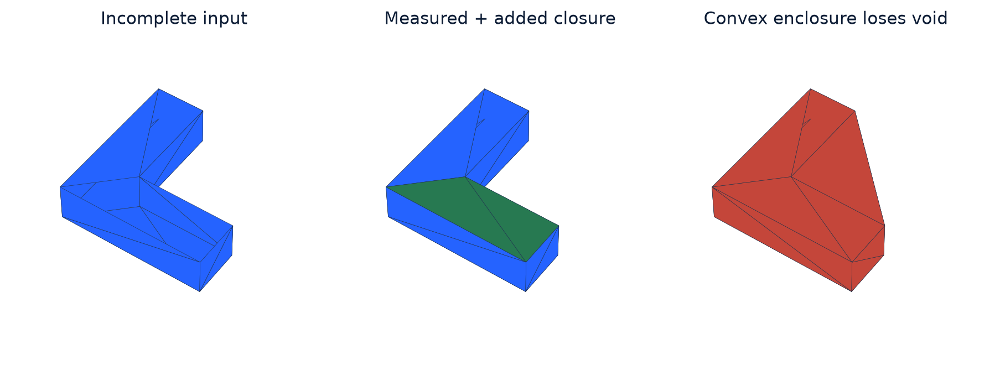
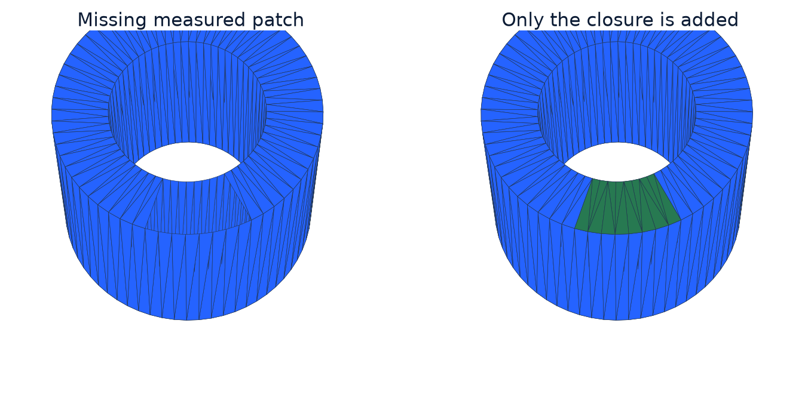
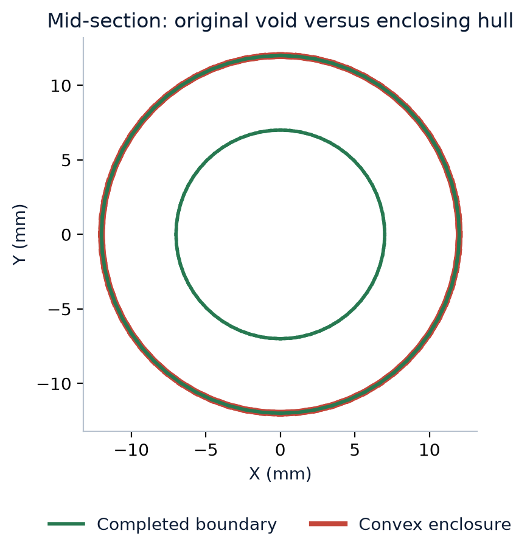
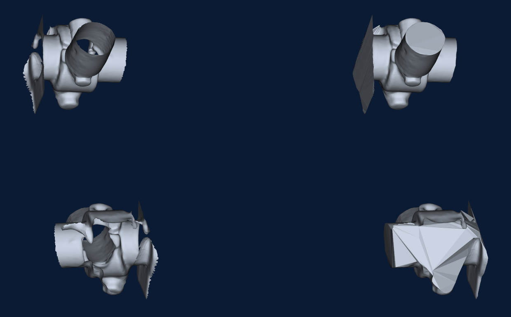

# Closing Incomplete Meshes Without Replacing Their Measured Surface

Version 1.0.

## Abstract

MeshMill completes missing scan surfaces by preserving measured triangles and constructing the missing boundary around them. The method divides the surrounding space into tetrahedra, labels material using oriented surface evidence, and repairs the resulting boundary locally. A concave bracket and a hollow tube demonstrate the result: the missing patches close, every input facet is retained, and the notch and through-hole remain empty. This paper explains the mathematics, implementation choices, and experiments behind that result.

## 1. What is being preserved?

The practical goal is a mesh that another program can treat as the boundary of a solid, while keeping the surfaces that were actually measured. In an STL file, this does not mean packing the interior with triangles. A closed, consistently oriented boundary tells a slicer where material is inside and where empty space is outside.

A hole through an object is different from a hole in its mesh. A hollow tube can have a valid closed boundary made from its outer wall, inner wall, and the rims joining them. The bore is meant to stay empty. A missing patch in one of those walls is a boundary defect. A useful completion method needs to close the defect without sealing the bore.

The measured surface supplies the boundary evidence. Its oriented facets constrain which adjacent regions contain material. The completion follows those constraints while constructing a boundary across the missing patch.

$$
F_{in}\subseteq F_{out},\qquad P_F=\frac{|F_{in}\cap F_{out}|}{|F_{in}|}
$$

| Symbol | Meaning |
| --- | --- |
| F_in,F_out | Canonical triangle-coordinate sets before and after completion. |
| P_F | Fraction of measured facets retained; tested at float32 output precision. |
| &#124;F&#124; | Number of distinct triangles in the set F. |

The retention fraction measures how much of the original surface is present in the completed result. The completion tests compare triangle coordinates at output precision, making preservation a direct check on the geometry rather than a judgment based on its appearance.

The two tests below remove known patches from otherwise closed objects. This supplies an independent target surface. The fixtures are deliberately simple enough to inspect: an L-shaped bracket with a concave notch and a hollow tube whose through-hole should remain empty. These experiments isolate completion before reduction.

The bracket test removes two triangles from a flat top surface. The tube test removes a patch from its annular top rim. Their original complete meshes supply the reference volumes and empty regions, so the added geometry can be checked against a known answer.

## 2. Constrained tetrahedra and surface-side evidence

The temporary tetrahedral mesh is a way to organize the decision about material. Each tetrahedron is a small four-cornered volume cell. Instead of guessing one large patch directly, the program decides which of these cells belong inside the object. The boundary between inside and outside cells becomes the completed surface. These temporary interior cells are not exported as extra internal geometry.

TetGen partitions a domain containing the input into tetrahedra. The implementation checks that the original coordinates and measured facets survived before accepting the volume mesh. Each tetrahedron receives an inside or outside label. Oriented measured faces constrain the labels of their adjacent tetrahedra.

$$
V_i=\frac{|\det(b-a,c-a,d-a)|}{6},\qquad A_f=\frac{\|(b-a)\times(c-a)\|}{2}
$$

| Symbol | Meaning |
| --- | --- |
| V_i | Volume of tetrahedron i with vertices a,b,c,d. |
| A_f | Area of face f with vertices a,b,c. |

Cell volumes and face areas matter because the decision should depend on physical geometry, not just the number of cells. Ten tiny cells should not outweigh one large region simply because there are more of them. The area of a shared face also measures how much new boundary would be created by assigning its two cells different labels.

$$
s_{if}=(c_i-m_f)\cdot n_f
$$

| Symbol | Meaning |
| --- | --- |
| c_i,m_f | Tetrahedron centroid and measured-face center. |
| n_f | Oriented measured-face normal. |
| s_if | Negative behind the face, positive in front; used for inside/outside constraints. |

Usable orientation matters. Contradictory support or an infeasible constrained mesh produces failure rather than permission to discard measured faces. A closest-surface signed query supplies a softer preference away from these hard constraints.

Face orientation supplies a consistent material direction. The method uses this information to keep the measured wall in place while finding the surrounding volume labels. Contradictory labels are detected during construction instead of being hidden by a replacement wrapper.

Signed surface distance supplies an initial inside/outside preference between the directly constrained regions. The measured face constraints anchor that initial estimate to the source. The graph then selects a boundary consistent with those anchors.

## 3. Choose a completion boundary

The energy expression puts three preferences into one score. First, avoid changing the provisional inside/outside estimate without reason. Second, avoid creating an unnecessarily large boundary between cells. Third, avoid extending material onto the outside of the temporary domain. The measured-face constraints take precedence over these preferences.

$$
E(l)=\sum_i\lambda V_i[l_i\ne q_i]+\sum_{(i,j)}A_{ij}[l_i\ne l_j]+\sum_{f\in H}A_f l_{o(f)}
$$

| Symbol | Meaning |
| --- | --- |
| l_i,q_i | Chosen binary volume label and provisional signed-surface classification. |
| A_ij | Shared-face area; neighboring pairs counted once. |
| H,o(f) | Outer-domain hull faces and the tetrahedron owning each face. |
| [condition] | One when true, otherwise zero. |
| E(l) | Total boundary-selection energy, in area units. |
| lambda, V_i | Area-to-volume scale and volume of cell i, defined in Relations 2 and 5. |
| A_f | Area of a hull face. A hull face has one owning tetrahedron. |

$$
\lambda=\frac{\sum_{f\in F_{in}}A_f}{\sum_i V_i}
$$

| Symbol | Meaning |
| --- | --- |
| lambda | Converts the volume disagreement term to area units. |
| F_in, A_f | Measured face set and each measured face area. |
| V_i | Volume of tetrahedron i. |

The unary term penalizes changing the provisional classification. Shared-face area penalizes an extensive cut, while the hull term controls material at the enclosing domain. PyMaxflow solves this labeling problem. Measured-side penalties are larger than the sum of finite costs, giving the source constraints precedence over the softer preferences.

The balancing factor has a practical purpose. Volume is measured in cubic units, while boundary area is measured in square units. Multiplying the disagreement volume by an area-to-volume ratio puts both costs on the same dimensional scale. This avoids treating a change of model size or units as though it were a new reason to prefer a different type of boundary.

Together, these terms produce a compact completion anchored to the measured surface. This is the reason the construction can close a missing patch while retaining a recess or bore: the retained walls constrain the material labels around those features.

## 4. Local structural repair

Structural cleanup checks how faces meet as well as whether the boundary is closed. Two closed pieces touching at one vertex can have the expected edge counts but disconnected face neighborhoods at that point. Intersection checks identify faces passing through one another. These checks address different geometric defects.

A short boundary can still be non-manifold. Local ambiguous neighborhoods are repaired with tetrahedron labels and boundary-face XOR variables through Python-SAT/RC2. Labels outside the patch and measured constraints remain fixed. The local objective favors small volume changes from the initial cut.

$$
b_f=l_i\oplus l_j,\qquad\sum_{f\supset e}b_f\leq2
$$

| Symbol | Meaning |
| --- | --- |
| b_f | Whether face f separates tetrahedra with different labels. |
| oplus | Exclusive OR; neighboring labels determine whether a boundary face exists. |
| e | Edge in the local repair neighborhood. |
| l_i,l_j | Inside/outside labels of the cells on either side of face f. |
| f contains e | The sum visits boundary-candidate faces incident on edge e. |

The XOR relation means a tetrahedral face is part of the output boundary when one neighboring cell is inside and the other is outside. The edge constraint limits how many such boundary faces can meet around an edge. These are local conditions on the same volume labeling, rather than independent triangles being patched together after the fact.

Vertex-fan and intersection checks complement edge incidence. Cleanup targets generated cap contacts, while the measured surface stays in place. This makes structural repair part of completion rather than a general smoothing pass over the source.

The local repair stage changes the neighborhood that requires correction. Labels elsewhere stay fixed, and measured constraints remain active. This keeps a local topology adjustment from becoming an unrelated change to the rest of the part.

## 5. Results: retained surfaces and preserved voids

The images use the same underlying geometry before and after completion. Blue faces came from the incomplete input. Green faces were generated. The red enclosure is included to make the difference in objectives visible: an enclosing hull can be perfectly reasonable when a wrapper is wanted, but it is not the desired answer when a notch or bore needs to remain empty.

| Fixture | Retained facets | Open edges | Volume error | Seconds |
| --- | --- | --- | --- | --- |
| concave bracket | 18/18 | 4 -> 0 | 0.00% | 1.61 |
| hollow tube | 496/496 | 18 -> 0 | 0.00% | 1.60 |

The measurements describe three parts of the result: open edges show that the removed boundary patch was closed; retained-facet counts show that measured triangles survived; and reference volume shows that the intended material region was recovered.

Both tests retained every measured input triangle and closed the deliberately removed patch. Reference and completed volumes agreed at the reported precision. These are single CPU construction runs, excluding application launch.

| Fixture | Known volume (mm3) | Completed (mm3) | Convex enclosure error |
| --- | --- | --- | --- |
| concave bracket | 4000.00 | 4000.00 | 40.00% |
| hollow tube | 5959.44 | 5959.44 | 51.58% |

Triangle-centroid distance samples were checked in both directions between the reference and completed surfaces. The bracket samples had zero measured deviation; the tube maximum was approximately 0.0000013 mm. These values record agreement between the constructed test meshes at the sampled locations.

The surface samples agree with the facet-retention and volume checks: the missing regions were reconstructed while the original boundary stayed in place. The test geometry makes that behavior visible and measurable, including the empty tube bore.

## 6. What earlier approaches taught

| Approach or check | Why it was insufficient for this objective |
| --- | --- |
| Global enclosure | Fills meaningful concavities or bores, as shown above. |
| Voxel reconstruction of the whole surface | Can replace measured detail with a sampled approximation; not required for this facet-constrained completion path. |
| Unrestricted repair | Can close an object by deleting a large measured patch. Retention therefore needs its own check. |
| Edge-only validation | Misses disconnected vertex fans and surface intersections. |

The earlier approaches explain the final design choices. Enclosure supplied a wrapper, while the intended result required retained recesses. Unrestricted repair motivated explicit source-facet retention. Point contacts and intersections motivated separate structural checks. Each observation led to a corresponding part of the implemented pipeline.

Preserving the source is part of the construction objective. The constraints, local repair, and output checks turn that objective into concrete operations on the mesh. The resulting surface can then continue through the application workflow.

## 7. Execution stages and resulting geometry

Closest-surface queries evaluate the relation of many cell centers to the source. These queries can run independently and suit parallel GPU execution. Constrained tetrahedralization, graph labeling, and local topology repair perform the remaining construction work.

The optional GPU query uses angle-weighted pseudonormal signs; the CPU path uses VTK implicit distance. The experiments reported here used the CPU path. Existing Depth + Density Adaptive QEM provides a subsequent reduction stage for the completed geometry.

The completed bracket retains its concave notch, and the completed tube retains its bore. Both retain every measured input triangle and have zero open edges. These results connect the mathematical constraints to the practical output: a closed material boundary that keeps the tested source features intact.

## References and implementation roles

- [TetGen](https://wias-berlin.de/software/tetgen/): Incorporated constrained tetrahedralization.
- [Boykov and Kolmogorov, min-cut/max-flow comparison](https://discovery.ucl.ac.uk/id/eprint/13383/): Upstream MAXFLOW citation; PyMaxflow supplies the cut implementation.
- [Python-SAT and RC2](https://github.com/pysathq/pysat): Incorporated SAT/MaxSAT infrastructure.
- [MeshFix and PyMeshFix](https://github.com/pyvista/pymeshfix): Incorporated repair and validation; Attene (2010), A Lightweight Approach to Repairing Digitized Polygon Meshes, is the upstream research citation.
- [Robust Inside-Outside Segmentation using Generalized Winding Numbers](https://users.cs.utah.edu/~ladislav/jacobson13robust/jacobson13robust.html): Related constrained-volume architecture; this implementation does not use its winding-number query.
